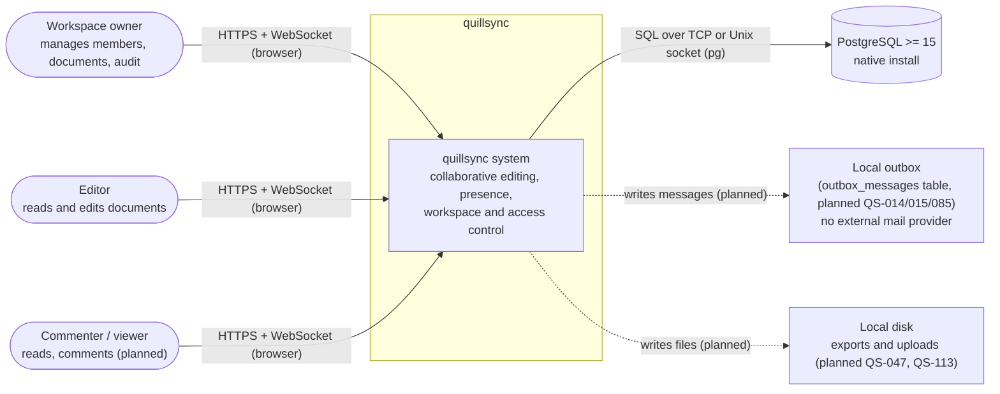
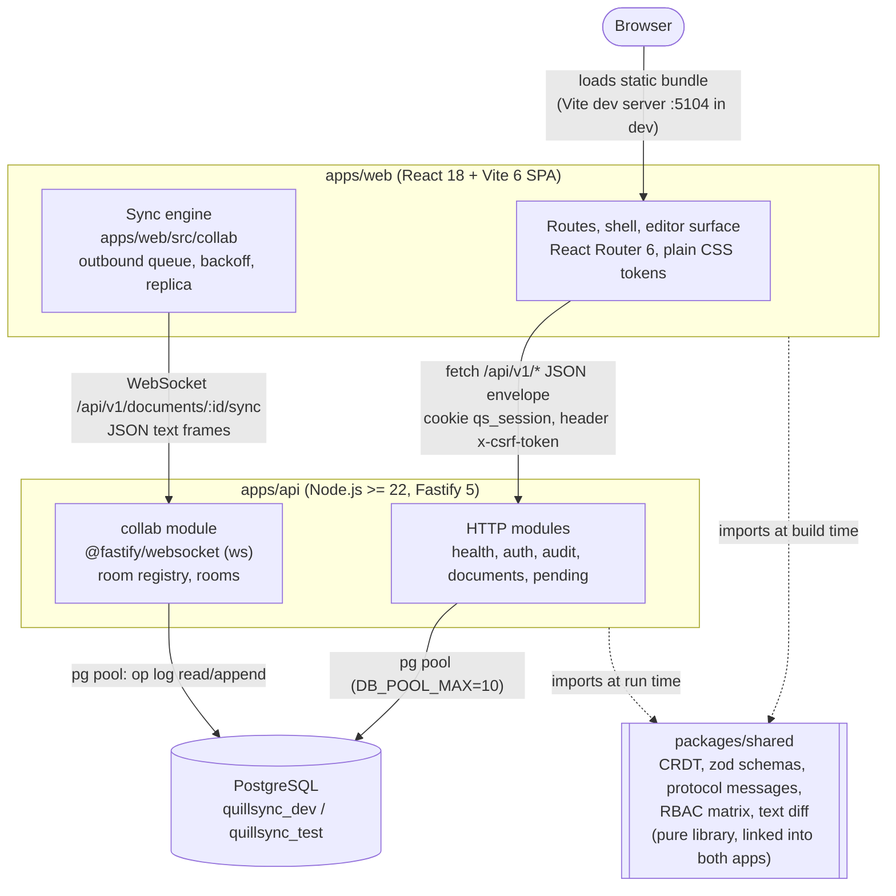
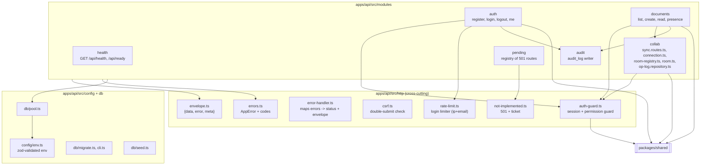
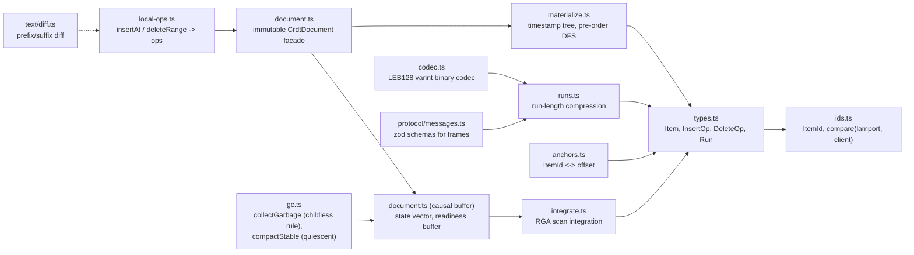
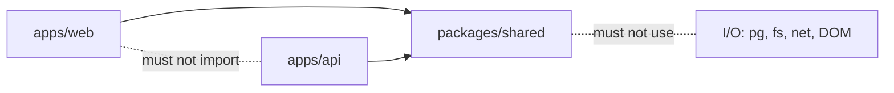
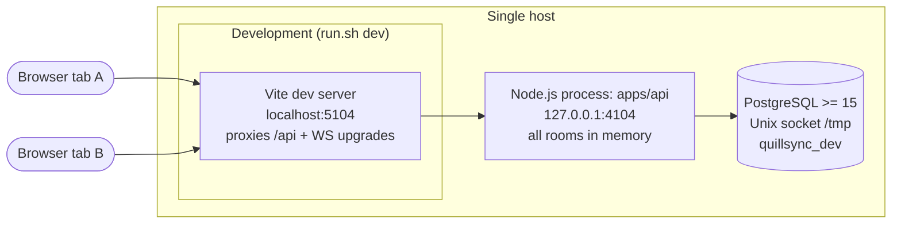

# Architecture overview

quillsync is a real-time collaborative document editor built around an in-house sequence CRDT (RGA). This document describes the system at three levels of the C4 model, the module boundaries inside the codebase, the dependency rules that keep those boundaries honest, the life of an HTTP request and of a WebSocket session, and the deployment topology today and after the multi-node work (QS-053, QS-054).

Related documents:

- [quality-attributes.md](quality-attributes.md): measurable targets and how they are verified
- [../design/system-design.md](../design/system-design.md): state machines, sequences, CRDT algorithms, consistency strategy
- [../design/data-model.md](../design/data-model.md): ERD, tables, indexes, migrations
- [../adr/README.md](../adr/README.md): architecture decision records
- [../planning/backlog.md](../planning/backlog.md): tickets (QS-xxx) referenced throughout
- [../product/requirements.md](../product/requirements.md): functional and non-functional requirements

Status markers used below: **implemented** means merged, tested and running in CI; **planned** means a backlog ticket exists and any API surface returns `501 NOT_IMPLEMENTED` with the ticket ID in `error.details.ticket`.

---

## 1. System context (C4 level 1)



quillsync has no third-party runtime dependencies beyond PostgreSQL. Email-like messages (invitations, password resets, digests) are written to a local outbox table rather than sent through an external provider; files (exports, image embeds) are stored on local disk. This keeps the system runnable from a single `run.sh` on a developer machine and in CI.

Actors and their roles map onto the RBAC matrix in `packages/shared/src/rbac/permissions.ts`:

| Role      | Permissions                                                                                                                                        |
| --------- | -------------------------------------------------------------------------------------------------------------------------------------------------- |
| owner     | all: `document:read`, `document:create`, `document:edit`, `document:comment`, `document:manage`, `member:manage`, `audit:read`, `workspace:manage` |
| editor    | `document:read`, `document:create`, `document:edit`, `document:comment`                                                                            |
| commenter | `document:read`, `document:comment`                                                                                                                |
| viewer    | `document:read`                                                                                                                                    |

---

## 2. Runtime units (C4 level 2)

The C4 model calls this level "containers"; in quillsync that word means only _separately running or separately deployed units_. No OS containers are used anywhere (see [ADR-0020](../adr/0020-no-containers-native-postgres.md)).



| Unit              | Technology                                                           | Listens on                                                                             | Responsibility                                                                                                                                                                            |
| ----------------- | -------------------------------------------------------------------- | -------------------------------------------------------------------------------------- | ----------------------------------------------------------------------------------------------------------------------------------------------------------------------------------------- |
| `apps/web`        | React 18, Vite 6, React Router 6, plain CSS with CSS-variable tokens | `WEB_PORT` 5104 (dev server; proxies `/api`, including WebSocket upgrades, to the API) | Login/register, app shell with planned-feature badges, document list, plain-text collaborative editor with remote carets, client replica and sync engine                                  |
| `apps/api`        | Fastify 5, `@fastify/websocket`, `@fastify/cookie`, `pg`, zod, pino  | `API_HOST:API_PORT` = 127.0.0.1:4104                                                   | JSON API, session auth, CSRF, RBAC, audit, document metadata, WebSocket sync rooms, op-log persistence                                                                                    |
| `packages/shared` | TypeScript, no I/O                                                   | n/a (library)                                                                          | CRDT (`crdt/*`), protocol message schemas (`protocol/messages.ts`), request/response schemas (`schemas/*`), RBAC matrix (`rbac/permissions.ts`), prefix/suffix text diff (`text/diff.ts`) |
| PostgreSQL        | >= 15, native install                                                | Unix socket `/tmp` locally; TCP in CI                                                  | Identity, sessions, memberships, audit log, documents, append-only op log                                                                                                                 |

`packages/shared` is the most important unit architecturally: the server and every browser tab run **the same CRDT code**, which is what makes the server's room state and each client's replica converge to identical text.

---

## 3. Components (C4 level 3)

### 3.1 API components



| Component | Key files           | Notes                                                                                                                                                                                                                                                                                                                        |
| --------- | ------------------- | ---------------------------------------------------------------------------------------------------------------------------------------------------------------------------------------------------------------------------------------------------------------------------------------------------------------------------- |
| health    | `modules/health`    | `/api/health` is liveness (process up); `/api/ready` checks a pool round trip (QS-004)                                                                                                                                                                                                                                       |
| auth      | `modules/auth`      | Registration creates an organization and its owner membership in one transaction (QS-008); login issues a 32-byte random token whose HMAC-SHA256 (keyed by `SESSION_SECRET`) is stored in `sessions.token_hash` (QS-009); `GET /me` returns user, organization, role, effective permissions and the CSRF token               |
| audit     | `modules/audit`     | Append-only writer for `audit_log`, called by other modules with `request_id` for correlation (QS-012). Query API planned (QS-019)                                                                                                                                                                                           |
| documents | `modules/documents` | Metadata CRUD (list/create/read implemented, rename/archive/trash planned QS-091). `GET /documents/:id` asks the room registry for the live room if loaded, otherwise rehydrates from the op log, and returns text, vector and op count                                                                                      |
| collab    | `modules/collab`    | `sync.routes.ts` owns the upgrade route and pre-upgrade checks; `connection.ts` validates and dispatches frames; `room-registry.ts` maps document id to room and handles load/unload; `room.ts` holds the authoritative replica and the per-room promise queue; `op-log.repository.ts` reads and appends `document_ops` rows |
| pending   | `modules/pending`   | Declarative list of every planned route with its ticket ID; each returns `501 NOT_IMPLEMENTED` with `error.details.ticket` (QS-013). Tests in `pending.test.ts` assert every entry                                                                                                                                           |

### 3.2 Shared library components



`document.ts` is the only entry point the apps use for state changes; it exposes pure functions that return a new document value (see [ADR-0015](../adr/0015-immutable-crdt-api-copy-on-write.md)).

### 3.3 Web components

| Component            | Location              | Responsibility                                                                                                                                                                                                                              |
| -------------------- | --------------------- | ------------------------------------------------------------------------------------------------------------------------------------------------------------------------------------------------------------------------------------------- |
| App shell and routes | `apps/web/src`        | Login, register, document list, editor route, navigation with "planned" badges for unimplemented features (QS-034)                                                                                                                          |
| API client           | `apps/web/src`        | `fetch` wrapper that unwraps the envelope and attaches `x-csrf-token` on unsafe methods                                                                                                                                                     |
| Sync engine          | `apps/web/src/collab` | Owns the client replica (`CrdtDocument`), the outbound queue of unacknowledged local ops, the connection state machine (idle → connecting → syncing → live → backoff) and presence                                                          |
| Editor surface       | `apps/web/src`        | `<textarea>` whose `input` events are converted into one delete + one insert by `text/diff.ts` ([ADR-0016](../adr/0016-textarea-diff-editor-before-contenteditable.md)); remote carets drawn as an overlay positioned from resolved anchors |

---

## 4. Module boundaries and dependency rules

### 4.1 Workspace layout

```
apps/
  api/      Fastify server, migrations, seed
  web/      React SPA
packages/
  shared/   pure TypeScript: crdt, protocol, schemas, rbac, text
e2e/        Playwright specs (not run in CI)
docs/
run.sh      launcher: help | setup | migrate | seed | reset | test | dev
```

### 4.2 Rules

| #   | Rule                                                                                                                                                                                | Rationale                                                                                                                    | Enforcement                                                                                                                                             |
| --- | ----------------------------------------------------------------------------------------------------------------------------------------------------------------------------------- | ---------------------------------------------------------------------------------------------------------------------------- | ------------------------------------------------------------------------------------------------------------------------------------------------------- |
| D1  | `packages/shared` imports nothing from `apps/*` and performs no I/O (no `fs`, `net`, `pg`, DOM, timers, `Math.random` inside algorithms except where a seeded source is injected)   | The CRDT must be deterministic and runnable identically in Node and the browser; property tests depend on seeded determinism | Workspace dependency graph (shared has no dependency on apps); lint import rules; code review                                                           |
| D2  | `apps/web` and `apps/api` never import each other                                                                                                                                   | They communicate only through the HTTP/WebSocket contract defined in `packages/shared`                                       | No workspace dependency between the two                                                                                                                 |
| D3  | Every wire shape (HTTP bodies, WebSocket frames) is defined once as a zod schema in `packages/shared` and parsed on both sides                                                      | Single source of truth for the contract ([ADR-0019](../adr/0019-zod-at-every-boundary.md))                                   | `protocol.test.ts`; route schemas reference shared schemas                                                                                              |
| D4  | API modules depend on `http/*`, `db/*`, `config/*` and `packages/shared`; a module may call another module only through its exported service functions, never its repository or SQL | Keeps modules extractable and their persistence private                                                                      | Directory structure; code review                                                                                                                        |
| D5  | Only `collab` mutates room state; `documents` reads through the room registry's public API                                                                                          | One writer per document state inside a process                                                                               | `room-registry.ts` is the only exporter of room handles                                                                                                 |
| D6  | Only `audit` writes `audit_log`                                                                                                                                                     | Consistent action naming and request correlation                                                                             | Single repository                                                                                                                                       |
| D7  | SQL lives in `*.repository.ts` files using parameterized queries; no string-concatenated SQL                                                                                        | Injection safety, reviewability                                                                                              | Code review; repositories are the only `pool.query` callers                                                                                             |
| D8  | Organization scoping (`organization_id`) is applied in every repository query on tenant data, taken from the authenticated session, never from client input                         | Tenancy isolation                                                                                                            | Repository signatures take `organizationId` as a required parameter; tests in `documents.test.ts` cover cross-organization access returning `NOT_FOUND` |



---

## 5. Request lifecycle: HTTP

Every JSON route goes through the same ordered pipeline of Fastify hooks and handlers. The order is deliberate: identifying the request comes first so that every subsequent log line and error carries `request_id`; authentication precedes CSRF because CSRF is only enforced for authenticated sessions; authorization precedes body validation so that an unauthorized caller cannot probe schema details.

```mermaid
sequenceDiagram
    autonumber
    participant B as Browser
    participant F as Fastify
    participant RID as onRequest: request id
    participant S as session resolver
    participant C as CSRF check
    participant R as RBAC guard
    participant Z as zod validation
    participant H as handler
    participant DB as PostgreSQL
    participant E as envelope / error handler

    B->>F: POST /api/v1/documents (cookies qs_session, qs_csrf; header x-csrf-token)
    F->>RID: assign request id (incoming x-request-id if well-formed, else new)
    RID->>S: read qs_session cookie
    S->>DB: SELECT session JOIN user, membership WHERE token_hash = hmac_sha256(SESSION_SECRET, token) AND expires_at > now()
    DB-->>S: session, user, organization, role
    S->>C: unsafe method and authenticated?
    C->>C: constant-time compare qs_csrf cookie vs x-csrf-token header
    alt mismatch or missing
        C-->>E: CSRF_INVALID (403)
    end
    C->>R: route requires permission document:create
    alt no session
        R-->>E: UNAUTHENTICATED (401)
    else role lacks permission
        R-->>E: FORBIDDEN (403)
    end
    R->>Z: parse params, query, body with shared zod schema
    alt invalid
        Z-->>E: VALIDATION_ERROR (400) with details (issue paths)
    end
    Z->>H: typed input + auth context {userId, organizationId, role}
    H->>DB: parameterized SQL scoped by organization_id
    H->>DB: audit_log insert (action, target, request_id)
    H-->>E: result
    E-->>B: 201 {data, error: null}
```

| Stage      | File                                              | Behaviour                                                                                                                                                                                                                                                                                                        |
| ---------- | ------------------------------------------------- | ---------------------------------------------------------------------------------------------------------------------------------------------------------------------------------------------------------------------------------------------------------------------------------------------------------------- |
| Request id | `http/*`, Fastify `genReqId`                      | Bound into the pino child logger; echoed in responses and written to `audit_log.request_id`                                                                                                                                                                                                                      |
| Session    | `http/auth-guard.ts`, `modules/auth`              | Cookie `qs_session` (HttpOnly, SameSite=Lax, Secure in production). Token is hashed with HMAC-SHA256 (keyed by `SESSION_SECRET`) before lookup, so a database leak does not yield usable tokens. `last_seen_at` is refreshed. Expired or unknown token = anonymous                                               |
| CSRF       | `http/csrf.ts`                                    | For POST/PUT/PATCH/DELETE on an authenticated request: cookie `qs_csrf` must equal header `x-csrf-token` (double submit, [ADR-0017](../adr/0017-postgres-sessions-scrypt-csrf-double-submit.md)). Login and register are exempt (no session yet) and protected by throttles, JSON-only bodies and `SameSite=Lax` |
| Rate limit | `http/rate-limit.ts`                              | Login: per normalised IP window, distinct emails per IP, per-email progressive backoff, all reserved before any await; registration per IP. Client IP from `TRUST_PROXY`. Excess returns `RATE_LIMITED` (429) with `Retry-After`                                                                                 |
| RBAC       | `http/auth-guard.ts` + `packages/shared/src/rbac` | Route declares a required permission; checked against the role matrix                                                                                                                                                                                                                                            |
| Validation | shared `schemas/*`                                | zod parse; failures become `VALIDATION_ERROR` with issue paths in `details`                                                                                                                                                                                                                                      |
| Handler    | `modules/*`                                       | Business logic and repository calls                                                                                                                                                                                                                                                                              |
| Envelope   | `http/envelope.ts`, `http/error-handler.ts`       | Success: `{data, error: null, meta?}`. Failure: `{data: null, error: {code, message, details?}}`. Unknown exceptions become `INTERNAL` (500) with the stack logged server-side only                                                                                                                              |

Error code to status mapping: `VALIDATION_ERROR` 400, `UNAUTHENTICATED` 401, `CSRF_INVALID` 403, `FORBIDDEN` 403, `NOT_FOUND` 404, `CONFLICT` 409 (planned endpoints), `PAYLOAD_TOO_LARGE` 413, `RATE_LIMITED` 429, `INTERNAL` 500, `NOT_IMPLEMENTED` 501, `UNAVAILABLE` 503.

Resources in another organization return `NOT_FOUND` rather than `FORBIDDEN`, so document IDs from other tenants cannot be confirmed to exist.

---

## 6. Request lifecycle: WebSocket sync

### 6.1 Upgrade

```mermaid
sequenceDiagram
    autonumber
    participant B as Browser (sync engine)
    participant F as Fastify + @fastify/websocket
    participant SR as sync.routes.ts
    participant DB as PostgreSQL
    participant RR as room-registry.ts
    participant RM as room.ts

    B->>F: GET /api/v1/documents/:id/sync (Upgrade: websocket, Origin, Cookie qs_session)
    F->>SR: preValidation
    SR->>SR: Origin == APP_ORIGIN ? (cross-site WebSocket hijacking defence)
    alt origin mismatch
        SR-->>B: 403 FORBIDDEN, no upgrade
    end
    SR->>DB: resolve session (same resolver as HTTP)
    alt no session
        SR-->>B: 401 UNAUTHENTICATED, no upgrade
    end
    SR->>DB: document exists in session.organization_id?
    alt not found / other tenant
        SR-->>B: 404 NOT_FOUND, no upgrade
    end
    SR->>F: accept upgrade; attach {userId, role, canEdit = role has document:edit}
    F-->>B: 101 Switching Protocols
    B->>SR: hello {clientId, vector, user}
    SR->>RR: getOrLoad(documentId)
    RR->>DB: SELECT payload FROM document_ops WHERE document_id = $1 ORDER BY id (if unloaded)
    RR->>RM: decode runs, materialize tree, build replica
    RM-->>B: welcome {vector, runs: ops with seq > hello.vector[client], peers}
```

CSRF tokens are not used for the WebSocket: browsers do not let cross-origin pages set the `Origin` header, so the exact `Origin == APP_ORIGIN` check plus the SameSite=Lax session cookie is the defence.

### 6.2 Message handling

| Direction | Frame                            | Handling                                                                                                                                                                                                                                                                                                                                             |
| --------- | -------------------------------- | ---------------------------------------------------------------------------------------------------------------------------------------------------------------------------------------------------------------------------------------------------------------------------------------------------------------------------------------------------- |
| C→S       | `hello {clientId, vector, user}` | Must be first frame. Registers the socket in the room; reply `welcome` with the delta (ops the client's vector does not cover) and current peers; broadcast `presence` of the new peer                                                                                                                                                               |
| C→S       | `ops {runs}`                     | Rejected with `error {code: FORBIDDEN}` if the role lacks `document:edit` (viewer, commenter). Otherwise enqueued on the room's promise queue: expand runs → integrate through the causal buffer → keep only newly integrated ops → persist one `document_ops` row → `ack {vector}` to sender → `ops {runs, from}` to every other socket in the room |
| C→S       | `presence {anchor, focused}`     | Anchor is an `ItemId                                                                                                                                                                                                                                                                                                                                 | null`; relayed to other sockets as `presence {peer}`; not persisted |
| C→S       | `ping`                           | `pong`                                                                                                                                                                                                                                                                                                                                               |
| S→C       | `error {code, message}`          | `VALIDATION_ERROR` for frames failing zod parse; `FORBIDDEN` for edits by read-only roles. The socket stays open for recoverable errors                                                                                                                                                                                                              |
| S→C       | `peer-left {clientId}`           | On socket close                                                                                                                                                                                                                                                                                                                                      |

Every frame is a JSON text frame parsed by the shared zod schemas in `protocol/messages.ts` ([ADR-0013](../adr/0013-json-text-frames-now-binary-later.md)). Frames larger than `WS_MAX_MESSAGE_BYTES` (262144) are refused by the socket layer. Per-connection rate limiting and backpressure are planned (QS-052); re-authorization of live sockets after a permission change is planned (QS-056).

---

## 7. Deployment topology

### 7.1 Today: single node (implemented)



- One API process holds every live room. Correctness relies on that: the room's promise queue is the single serialization point for a document ([ADR-0012](../adr/0012-single-process-authoritative-rooms.md)).
- `run.sh dev` performs `setup` (creates `.env` with a random `SESSION_SECRET` of at least 32 characters, creates the databases, migrates, seeds) and starts both processes.
- CI (`.github/workflows/ci.yml`) runs on `ubuntu-latest` with the runner's native PostgreSQL started through `systemctl`; no OS containers ([ADR-0020](../adr/0020-no-containers-native-postgres.md)).
- Production deployment scripts (systemd units, nginx reverse proxy with TLS termination and WebSocket upgrade forwarding) are planned in QS-137.

### 7.2 Planned: multiple nodes (QS-053, QS-054)

```mermaid
flowchart TB
    lb["nginx (QS-137)<br/>TLS, WS upgrade,<br/>hash on document id"]
    subgraph n1["API node 1"]
        r1["room doc-A (owner)"]
        r2["room doc-B (follower)"]
    end
    subgraph n2["API node 2"]
        r3["room doc-B (owner)"]
        r4["room doc-A (follower)"]
    end
    pg[("PostgreSQL<br/>document_ops,<br/>advisory locks,<br/>LISTEN/NOTIFY")]
    lb --> n1
    lb --> n2
    n1 <-- "NOTIFY qs_ops {document_id, op_row_id}" --> pg
    n2 <-- "LISTEN qs_ops" --> pg
```



- **Fan-out (QS-053):** after a node persists an op batch it issues `NOTIFY` with the document id and the new `document_ops.id` (not the payload; NOTIFY payloads are limited to 8000 bytes). Other nodes holding sockets for that document read the row and fan it out locally. Because the CRDT is idempotent and order-insensitive, duplicate or reordered notifications are harmless.
- **Ownership (QS-054):** one node per document holds a PostgreSQL advisory lock keyed by a hash of the document id and is the only node that integrates and persists ops for it; other nodes forward client `ops` frames to the owner. On owner failure the session-level lock is released with its connection and another node acquires it, rehydrates from the op log, and continues. `UNIQUE(document_id, client_id, seq_start)` prevents duplicate rows if two nodes briefly both believe they own a room.
- Load balancer affinity on the document id is an optimization that reduces forwarding; correctness does not depend on it.

---

## 8. Cross-cutting concerns

| Concern                | Approach                                                                                                    | Reference                                |
| ---------------------- | ----------------------------------------------------------------------------------------------------------- | ---------------------------------------- |
| Configuration          | `config/env.ts` parses all env vars with zod at start-up and exits on failure                               | QS-002                                   |
| Logging                | pino JSON logs with `request_id`, `userId`, `documentId` where known; no document text or tokens are logged | QS-002                                   |
| Errors                 | Typed `AppError` with code; central handler; unknown errors logged with stack, returned as `INTERNAL`       | QS-003                                   |
| Tenancy                | `organization_id` on every tenant table and in every repository query                                       | [data-model.md](../design/data-model.md) |
| Audit                  | `audit_log` rows for auth and document actions, correlated by `request_id`                                  | QS-012, QS-019                           |
| Metrics                | Planned Prometheus text endpoint `GET /api/metrics`                                                         | QS-130                                   |
| Security headers / CSP | Planned                                                                                                     | QS-132                                   |
