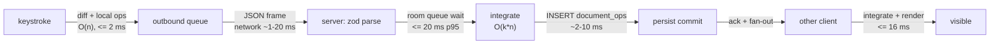

# Quality attributes

This document turns the non-functional requirements (see [../product/requirements.md](../product/requirements.md), NFR section) into measurable targets, names the test or benchmark that verifies each one, and records the current status. Architecture context is in [overview.md](overview.md); algorithms referenced here are specified in [../design/system-design.md](../design/system-design.md).

Status legend:

- **Verified**: an automated test in CI asserts the target.
- **Partially verified**: a test covers the behaviour but not the full numeric target, or the test exists but is not run in CI.
- **Not yet measured**: the target is set; the ticket that builds the measurement is pending.

Reference environment for numeric targets (until QS-131 defines a dedicated load rig): a single API process on a 4-core x86-64 machine with 8 GB RAM, PostgreSQL 15+ on the same host, clients on the same LAN.

---

## 1. Summary

| ID        | Attribute                  | Target                                                                                                                                                               | Verified by                                                                           | Status                                                  |
| --------- | -------------------------- | -------------------------------------------------------------------------------------------------------------------------------------------------------------------- | ------------------------------------------------------------------------------------- | ------------------------------------------------------- |
| QA-LAT-1  | Local edit latency         | Keystroke to updated local text and caret <= 16 ms (one frame) p99 for documents up to 50 000 characters                                                             | `sync-client.test.ts` (functional); QS-045 benchmark (numeric)                        | Partially verified                                      |
| QA-LAT-2  | Remote propagation latency | Sender keystroke to visible on another client p95 <= 150 ms, p99 <= 300 ms, single node, 10 editors in a room                                                        | QS-131 load harness; `collaboration.spec.ts` (functional, not in CI)                  | Not yet measured                                        |
| QA-LAT-3  | HTTP latency               | Read endpoints (`GET /documents`, `GET /auth/me`) p95 <= 100 ms; `GET /documents/:id` p95 <= 250 ms for 50 000-character documents with cold room                    | QS-131                                                                                | Not yet measured                                        |
| QA-LAT-4  | Room rehydration           | Cold load of a document with 100 000 ops <= 500 ms (decode + tree materialization)                                                                                   | `room.test.ts` (functional); QS-045 (numeric)                                         | Partially verified                                      |
| QA-CONV-1 | Convergence                | 100% of seeded random scenarios converge: all replicas produce identical text and identical item order after receiving the same op set in any order, with duplicates | `convergence.property.test.ts` (QS-027)                                               | Verified                                                |
| QA-CONV-2 | Scan/tree equivalence      | Scan integration and tree materialization produce identical item order for every random op set                                                                       | `materialize.test.ts`, `convergence.property.test.ts`                                 | Verified                                                |
| QA-CONV-3 | Intention preservation     | Concurrent runs typed at the same position never interleave                                                                                                          | `integrate.test.ts`                                                                   | Verified                                                |
| QA-DUR-1  | Durability                 | Zero loss of acknowledged ops across a process restart (RPO = 0 for acked ops)                                                                                       | `collab-sync.test.ts` (persistence and rehydration)                                   | Verified (restart); crash-injection test pending QS-134 |
| QA-DUR-2  | Unacknowledged edits       | Edits made during a disconnect are merged on reconnect while the tab stays open; across tab close after QS-120                                                       | `sync-client.test.ts` (queue, resend)                                                 | Verified (in-memory); IndexedDB pending QS-120          |
| QA-DUR-3  | Backup restorability       | `pg_dump` / restore round trip reproduces identical text for every document                                                                                          | QS-064 tooling                                                                        | Not yet measured                                        |
| QA-THR-1  | Room throughput            | >= 200 integrated ops/s sustained per room with 10 editors, p95 queue wait <= 20 ms                                                                                  | QS-131                                                                                | Not yet measured                                        |
| QA-THR-2  | Node capacity              | >= 500 concurrent sockets across >= 100 rooms per node with CPU < 70%                                                                                                | QS-131                                                                                | Not yet measured                                        |
| QA-MEM-1  | Memory per room            | <= 256 bytes per retained item (visible or tombstone) on the server; idle room memory released after last socket leaves                                              | QS-045 heap snapshots; `room.test.ts` (unload)                                        | Partially verified (unload only)                        |
| QA-MEM-2  | Tombstone growth           | Server tombstone count bounded by edits since the GC frontier once QS-062 lands                                                                                      | `gc.test.ts` (library)                                                                | Partially verified                                      |
| QA-WIRE-1 | Encoding efficiency        | Typing a 1 000-character paragraph persists as <= 1.2 KB of `document_ops.payload` (runs + varints)                                                                  | `runs.test.ts`, `codec.test.ts`                                                       | Verified                                                |
| QA-SEC-1  | Authentication             | Passwords hashed with salted scrypt; session tokens 32 random bytes, only an HMAC-SHA256 stored; cookies HttpOnly, SameSite=Lax, Secure in production                | `auth.test.ts`                                                                        | Verified                                                |
| QA-SEC-2  | CSRF                       | 100% of state-changing authenticated HTTP routes reject missing or mismatched `x-csrf-token`                                                                         | `auth.test.ts`                                                                        | Verified                                                |
| QA-SEC-3  | Brute force                | Per-IP (30/15 min), distinct-emails-per-IP (20/15 min) and per-email backoff (5 free, then 30 s doubling) return 429; attempts reserved before any await             | `auth.test.ts`                                                                        | Verified                                                |
| QA-SEC-4  | WebSocket access           | Upgrade refused for foreign Origin, missing session, or document outside the organization; edits from viewer/commenter rejected with `FORBIDDEN`                     | `collab-sync.test.ts`                                                                 | Verified                                                |
| QA-SEC-5  | Input robustness           | Malformed frames and binary payloads never crash the process; codec rejects all malformed input with `CodecError`                                                    | `codec.test.ts` (fuzz), `collab-sync.test.ts` (malformed message)                     | Verified                                                |
| QA-SEC-6  | Tenancy isolation          | No endpoint returns data from another organization                                                                                                                   | `documents.test.ts`                                                                   | Verified for implemented routes                         |
| QA-SEC-7  | Headers and dependencies   | CSP and security headers on all responses; CI fails on high-severity advisories                                                                                      | QS-132                                                                                | Not yet measured                                        |
| QA-A11Y-1 | Accessibility              | WCAG 2.2 AA for shell and editor; keyboard-only operation of every implemented feature; remote carets not conveyed by colour alone                                   | QS-133 audit; RTL tests (`login.test.tsx`, `app-shell.test.tsx`, `presence.test.tsx`) | Partially verified                                      |
| QA-MNT-1  | Test coverage              | >= 80% line coverage per workspace; >= 90% for `packages/shared/src/crdt`                                                                                            | Vitest coverage in `npm test`                                                         | Verified in CI                                          |
| QA-MNT-2  | Static quality             | Zero ESLint errors, Prettier clean, `tsc --strict` clean                                                                                                             | CI steps `lint`, `format:check`, `typecheck`                                          | Verified                                                |
| QA-MNT-3  | Code size                  | Files <= 800 lines (typical 200-400), functions < 50 lines, nesting <= 4                                                                                             | Code review; lint rules                                                               | Partially verified                                      |
| QA-MNT-4  | Contract stability         | Every wire shape defined once in `packages/shared` and parsed on both ends                                                                                           | `protocol.test.ts`                                                                    | Verified                                                |
| QA-OPS-1  | Observability              | Every log line carries `request_id`; metrics for rooms, sockets, ops/s, queue depth, persist latency                                                                 | pino config; QS-130                                                                   | Partially verified                                      |
| QA-PORT-1 | Reproducible setup         | Fresh clone to running app with `./run.sh` and a native PostgreSQL in <= 5 minutes; no OS containers                                                                 | CI (`ci.yml`) exercises setup + migrate + test                                        | Verified                                                |

---

## 2. Latency

### 2.1 Budget for a remote edit (QA-LAT-2)

The dominant controllable terms are the persist round trip (persist-before-ack, [ADR-0012](../adr/0012-single-process-authoritative-rooms.md)) and the O(n) array integration. QS-043 (order-statistic B-tree) reduces integration to O(log n) if QS-045 shows the array term exceeding 5 ms at the target document size.

### 2.2 Local latency (QA-LAT-1)

The textarea path is: `input` event → `text/diff.ts` (O(n) prefix/suffix scan) → `local-ops.ts` (O(n) position-to-item lookup) → new immutable document → re-render. At 50 000 characters each O(n) pass is a single tight loop over an array; the 16 ms budget leaves headroom for React reconciliation of the overlay layer only (the textarea value is set directly).

---

## 3. Convergence (QA-CONV-1..3)

Convergence is the primary correctness property of the system and is verified, not argued:

- `convergence.property.test.ts` builds N replicas (2 to 5), drives each with random local inserts and deletes from a seeded PRNG, exchanges ops through a simulated network that **reorders, duplicates and delays** messages, and finally delivers everything to everyone. It asserts identical visible text, identical full item order (tombstones included) and identical state vectors. Failing seeds are printed so they can be pinned as regression cases.
- The same harness applies the op set once through scan integration and once through tree materialization and asserts equality (QA-CONV-2).
- `integrate.test.ts` contains hand-written interleaving cases: two runs typed concurrently at the same origin, insert after a concurrently deleted character, and delete of a character whose insert has not yet arrived (buffered by `document.ts`).
- QS-045 extends this to large-scale fuzzing (long histories, 10+ replicas) and benchmarks.

The convergence argument behind these tests is in [system-design.md section 5.4](../design/system-design.md#54-convergence-argument).

---

## 4. Durability

| Failure                             | Behaviour                                                                                                      | Evidence                                                                   |
| ----------------------------------- | -------------------------------------------------------------------------------------------------------------- | -------------------------------------------------------------------------- |
| API process exits after `ack`       | Op is in `document_ops` (ack is sent only after commit)                                                        | `collab-sync.test.ts` reloads the room from the database and compares text |
| API process exits before commit     | No ack sent; client keeps ops in its outbound queue and resends after reconnect                                | `sync-client.test.ts`                                                      |
| Duplicate resend after commit       | Room vector filters already-integrated ops; `UNIQUE(document_id, client_id, seq_start)` rejects duplicate rows | `room.test.ts`, `collab-sync.test.ts`                                      |
| Browser tab closed with unacked ops | Lost today; persisted to IndexedDB after QS-120                                                                | QS-120                                                                     |
| Database loss                       | Restore from `pg_dump`; verification tooling QS-064                                                            | QS-064                                                                     |

---

## 5. Throughput and memory

Not yet measured; QS-131 builds a load harness that opens many WebSocket clients replaying recorded typing traces, and QS-045 adds micro-benchmarks for integrate, materialize, encode and decode. Until then the following design limits apply:

- `WS_MAX_MESSAGE_BYTES` = 262144 caps a single batch.
- One `document_ops` row per integrated batch keeps write amplification proportional to batches, not characters.
- Rooms are unloaded when the last socket leaves, so memory is proportional to _active_ documents.
- Server-side tombstone GC (QS-062) and snapshots (QS-060) bound rehydration cost and per-room memory for long-lived documents.

---

## 6. Security

Targets QA-SEC-1..7 are verified by API integration tests running against a real PostgreSQL database (`quillsync_test`). Details of the mechanisms are in [ADR-0017](../adr/0017-postgres-sessions-scrypt-csrf-double-submit.md) and the overview's [HTTP lifecycle](overview.md#5-request-lifecycle-http). Pending hardening: CSP and dependency audit gate (QS-132), session listing and revocation with idle timeout (QS-016), permission revocation on live sockets (QS-056), per-connection op rate limiting (QS-052).

---

## 7. Accessibility

Target WCAG 2.2 AA. Current coverage: form labelling and keyboard flow in `login.test.tsx`; landmark structure and planned-feature badges announced as text in `app-shell.test.tsx`; remote carets carry the peer's display name as text in `presence.test.tsx`, so colour is not the only signal. The editor is a native `<textarea>`, which inherits platform screen-reader and IME support ([ADR-0016](../adr/0016-textarea-diff-editor-before-contenteditable.md)). A full audit with assistive technology is scheduled after the rich-text surface (QS-133, depends on QS-050).

---

## 8. Maintainability

- Strict TypeScript across all workspaces; zod schemas are the single source of truth for runtime shapes ([ADR-0019](../adr/0019-zod-at-every-boundary.md)).
- The CRDT is a pure, immutable library with no I/O, so every algorithm is unit-testable in isolation ([ADR-0015](../adr/0015-immutable-crdt-api-copy-on-write.md)).
- Modules are separated by domain with explicit dependency rules ([overview section 4](overview.md#4-module-boundaries-and-dependency-rules)).
- CI runs lint, format check, typecheck, tests (with coverage) and build on every push.
