# Data model

The PostgreSQL schema for quillsync: the target entity-relationship model covering migrated and planned tables, table-by-table notes, indexes, tenancy, retention, and the migration plan. Design rationale: [ADR-0011](../adr/0011-op-log-postgres-bytea-batches.md) (op log), [ADR-0017](../adr/0017-postgres-sessions-scrypt-csrf-double-submit.md) (sessions), [ADR-0018](../adr/0018-plain-sql-forward-only-migrations.md) (migrations). Behaviour: [system-design.md](system-design.md).

Conventions:

- Primary keys are `uuid` except for append-only, high-volume logs (`audit_log`, `document_ops`), which use `bigserial`. That gives a cheap, strictly increasing server order.
- Timestamps are `timestamptz`, default `now()`.
- **Tenancy:** every table holding workspace data carries `organization_id uuid NOT NULL REFERENCES organizations(id)`, including child tables such as `document_ops` where it could be derived through a join. Every repository query filters on the session's organization (rule D8 in the [overview](../architecture/overview.md#42-rules)), and the denormalized column lets each query be checked on its own row without a join.
- Secrets are never stored in plaintext. Session, invitation, password-reset and share-link tokens are stored as `sha256` digests (`bytea`); passwords are stored as scrypt hashes.
- Markers: **[M]** migrated today, **[P]** planned (ticket in the notes).

---

## 1. Target ERD

```mermaid
erDiagram
    organizations ||--o{ memberships : has
    users ||--o{ memberships : holds
    users ||--o{ sessions : authenticates
    organizations ||--o{ sessions : scopes
    organizations ||--o{ audit_log : records
    users |o--o{ audit_log : acts

    organizations ||--o{ documents : owns
    users ||--o{ documents : creates
    documents ||--o{ document_ops : "op log"
    users ||--o{ document_ops : authors

    organizations ||--o{ folders : owns
    folders |o--o{ folders : parent
    folders |o--o{ documents : contains
    documents |o--o{ document_permissions : grants
    folders |o--o{ document_permissions : grants
    users ||--o{ document_permissions : principal
    documents ||--o{ share_links : shares

    organizations ||--o{ invitations : issues
    users ||--o{ password_resets : requests
    organizations |o--o{ outbox_messages : queues

    documents ||--o{ document_snapshots : snapshots
    documents ||--o{ document_replicas : "ack vectors"
    documents ||--o{ document_versions : versions
    document_snapshots ||--o{ document_versions : "backs"

    documents ||--o{ comment_threads : discusses
    comment_threads ||--|| comment_anchors : "anchored by"
    comment_threads ||--o{ comments : contains
    comments ||--o{ comment_reactions : receives
    comments ||--o{ mentions : contains
    users ||--o{ mentions : "is mentioned"
    users ||--o{ notifications : receives

    documents ||--o{ export_jobs : exports
    documents |o--o{ uploads : embeds

    organizations {
        uuid id PK
        text name
        text slug UK
        timestamptz created_at
    }
    users {
        uuid id PK
        text email UK "lower-case"
        text display_name
        text password_hash "scrypt"
        timestamptz created_at
    }
    memberships {
        uuid organization_id PK,FK
        uuid user_id PK,FK
        text role "owner|editor|commenter|viewer"
        timestamptz created_at
    }
    sessions {
        uuid id PK
        bytea token_hash UK "sha256"
        uuid user_id FK
        uuid organization_id FK
        timestamptz created_at
        timestamptz expires_at
        timestamptz last_seen_at
        inet ip
        text user_agent
    }
    audit_log {
        bigserial id PK
        uuid organization_id FK
        uuid actor_user_id FK
        text action
        text target_type
        text target_id
        jsonb metadata
        text request_id
        timestamptz created_at
    }
    documents {
        uuid id PK
        uuid organization_id FK
        uuid folder_id FK "planned QS-090"
        text title
        uuid created_by FK
        timestamptz created_at
        timestamptz updated_at
        timestamptz archived_at
        timestamptz trashed_at "planned QS-091"
        tsvector search_vector "planned QS-100"
    }
    document_ops {
        bigserial id PK "server order"
        uuid document_id FK
        uuid organization_id FK
        text client_id
        bigint seq_start
        bigint seq_end
        int op_count
        bytea payload "binary codec"
        uuid author_user_id FK
        timestamptz created_at
    }
    folders {
        uuid id PK
        uuid organization_id FK
        uuid parent_id FK
        text name
        uuid created_by FK
        timestamptz created_at
        timestamptz trashed_at
    }
    document_permissions {
        uuid id PK
        uuid organization_id FK
        uuid document_id FK "xor folder_id"
        uuid folder_id FK
        uuid user_id FK
        text role
        uuid granted_by FK
        timestamptz created_at
    }
    share_links {
        uuid id PK
        uuid organization_id FK
        uuid document_id FK
        bytea token_hash UK
        text role "viewer|commenter|editor"
        timestamptz expires_at
        timestamptz revoked_at
        uuid created_by FK
        timestamptz created_at
    }
    invitations {
        uuid id PK
        uuid organization_id FK
        text email
        text role
        bytea token_hash UK
        uuid invited_by FK
        timestamptz expires_at
        timestamptz accepted_at
        timestamptz created_at
    }
    password_resets {
        uuid id PK
        uuid user_id FK
        bytea token_hash UK
        timestamptz expires_at
        timestamptz used_at
        timestamptz created_at
    }
    outbox_messages {
        bigserial id PK
        uuid organization_id FK
        text kind "invitation|password_reset|digest"
        text recipient
        text subject
        text body
        jsonb payload
        timestamptz created_at
        timestamptz delivered_at
    }
    document_snapshots {
        uuid id PK
        uuid document_id FK
        uuid organization_id FK
        jsonb vector
        bigint up_to_op_id "last covered document_ops.id"
        jsonb gc_vector "stable vector applied"
        boolean compacted "compactStable applied"
        bytea payload
        int item_count
        int tombstone_count
        timestamptz created_at
    }
    document_replicas {
        uuid document_id PK,FK
        text client_id PK
        uuid organization_id FK
        uuid user_id FK
        jsonb ack_vector
        timestamptz last_seen_at
        timestamptz evicted_at
    }
    document_versions {
        uuid id PK
        uuid document_id FK
        uuid organization_id FK
        uuid snapshot_id FK
        text kind "auto|named"
        text name
        uuid created_by FK
        timestamptz created_at
    }
    comment_threads {
        uuid id PK
        uuid document_id FK
        uuid organization_id FK
        text status "open|resolved"
        uuid created_by FK
        uuid resolved_by FK
        timestamptz resolved_at
        timestamptz created_at
    }
    comment_anchors {
        uuid thread_id PK,FK
        text start_client_id
        bigint start_seq
        text end_client_id
        bigint end_seq
        text quoted_text
    }
    comments {
        uuid id PK
        uuid thread_id FK
        uuid organization_id FK
        uuid author_user_id FK
        text body
        timestamptz edited_at
        timestamptz deleted_at
        timestamptz created_at
    }
    comment_reactions {
        uuid comment_id PK,FK
        uuid user_id PK,FK
        text emoji PK
        timestamptz created_at
    }
    mentions {
        uuid id PK
        uuid comment_id FK
        uuid mentioned_user_id FK
        uuid organization_id FK
        timestamptz created_at
    }
    notifications {
        uuid id PK
        uuid organization_id FK
        uuid user_id FK
        text kind
        jsonb payload
        timestamptz read_at
        timestamptz created_at
    }
    export_jobs {
        uuid id PK
        uuid organization_id FK
        uuid document_id FK
        uuid requested_by FK
        text format "markdown|html|archive"
        text status "queued|running|done|failed"
        text file_path
        text error
        timestamptz created_at
        timestamptz finished_at
    }
    uploads {
        uuid id PK
        uuid organization_id FK
        uuid document_id FK
        uuid uploaded_by FK
        bytea sha256
        text mime_type
        bigint byte_size
        text storage_path
        timestamptz created_at
    }
```

---

## 2. Migrated tables

### 2.1 Identity and access (0001_foundation.sql) [M]

| Table           | Columns and constraints                                                                                                                                                                                                | Notes                                                                                                                                                                                                                 |
| --------------- | ---------------------------------------------------------------------------------------------------------------------------------------------------------------------------------------------------------------------- | --------------------------------------------------------------------------------------------------------------------------------------------------------------------------------------------------------------------- |
| `organizations` | `id uuid PK`, `name text NOT NULL`, `slug text UNIQUE NOT NULL`, `created_at`                                                                                                                                          | Tenancy root. Registration creates one, with its owner membership, in a single transaction (QS-008). Seed: "Northwind Editorial", slug `northwind`                                                                    |
| `users`         | `id uuid PK`, `email text UNIQUE NOT NULL` (stored lower-case), `display_name text NOT NULL`, `password_hash text NOT NULL`, `created_at`                                                                              | Global identity. A user may belong to several organizations once QS-094 lands. `password_hash` is a salted scrypt string                                                                                              |
| `memberships`   | `organization_id FK`, `user_id FK`, `role text CHECK (role IN ('owner','editor','commenter','viewer'))`, `created_at`, `PRIMARY KEY (organization_id, user_id)`                                                        | The role feeds the RBAC matrix in `packages/shared/src/rbac`. The composite PK means one role per user per organization                                                                                               |
| `sessions`      | `id uuid PK`, `token_hash bytea UNIQUE NOT NULL` (HMAC-SHA256, keyed by SESSION_SECRET, of a random 32-byte token), `user_id FK`, `organization_id FK`, `created_at`, `expires_at`, `last_seen_at`, `ip`, `user_agent` | Each session belongs to one organization (the active workspace). `expires_at = created_at + SESSION_TTL_HOURS` (168). `ip` and `user_agent` are kept for the planned session listing (QS-016). Logout deletes the row |
| `audit_log`     | `id bigserial PK`, `organization_id FK`, `actor_user_id` (nullable for system actions), `action text`, `target_type text`, `target_id text`, `metadata jsonb`, `request_id text`, `created_at`                         | Append-only; written only by the audit module (rule D6). `request_id` ties each row to its pino log lines. The query API is planned (QS-019)                                                                          |

### 2.2 Documents and op log (0002_documents_op_log.sql) [M]

| Table          | Columns and constraints                                                                                                                                                                                                                                  | Notes                                                                                                                                                                                                                                                                                                                                                                               |
| -------------- | -------------------------------------------------------------------------------------------------------------------------------------------------------------------------------------------------------------------------------------------------------- | ----------------------------------------------------------------------------------------------------------------------------------------------------------------------------------------------------------------------------------------------------------------------------------------------------------------------------------------------------------------------------------- |
| `documents`    | `id uuid PK`, `organization_id FK`, `title text`, `created_by FK users`, `created_at`, `updated_at`, `archived_at timestamptz NULL`                                                                                                                      | Metadata only. Document **content** lives in `document_ops`, and later also in `document_snapshots`. `updated_at` is bumped when an op batch persists. `archived_at` is already present; the archive endpoints are QS-091                                                                                                                                                           |
| `document_ops` | `id bigserial PK` (server order), `document_id FK`, `organization_id FK`, `client_id text`, `seq_start bigint`, `seq_end bigint`, `op_count int`, `payload bytea`, `author_user_id FK users`, `created_at`, `UNIQUE (document_id, client_id, seq_start)` | One row per integrated batch from one client. `payload` holds the binary codec encoding of the batch's runs (system-design 4.5). The seq range `[seq_start, seq_end]` is contiguous for `client_id`; `op_count = seq_end - seq_start + 1`. The unique constraint, used with `ON CONFLICT DO NOTHING`, makes inserts idempotent (system-design 5.3). Rehydration reads `ORDER BY id` |

Invariants that the room enforces before insert, since the database cannot check payload contents:

- `seq_start = previous room.vector[client_id] + 1`. Batches therefore never overlap for a client, and the rows for a client tile its seq space with no gaps.
- `author_user_id` is the authenticated user behind the socket. A client id is never trusted as identity.

---

## 3. Planned tables

| Table                                               | Ticket(s)              | Key columns and constraints                                                                                                        | Notes                                                                                                                                                                                                                                                                                                                       |
| --------------------------------------------------- | ---------------------- | ---------------------------------------------------------------------------------------------------------------------------------- | --------------------------------------------------------------------------------------------------------------------------------------------------------------------------------------------------------------------------------------------------------------------------------------------------------------------------- |
| `folders`                                           | QS-090                 | `parent_id uuid NULL REFERENCES folders`, `UNIQUE (organization_id, parent_id, name)`, `trashed_at`                                | Adjacency list. Moves are checked against cycles with a recursive CTE inside the move transaction. `documents.folder_id` is added as a nullable FK                                                                                                                                                                          |
| `documents.trashed_at`                              | QS-091                 | nullable `timestamptz`                                                                                                             | Trash is a soft delete; permanent delete cascades to all document children                                                                                                                                                                                                                                                  |
| `document_permissions`                              | QS-092                 | `CHECK ((document_id IS NULL) <> (folder_id IS NULL))`, `role` with the same check as memberships, unique per (target, user)       | Grants on a folder are inherited by its subtree. The effective role is max(membership role, nearest grant) and is resolved at authorization time. Revoking a grant must also reach live sockets (QS-056)                                                                                                                    |
| `share_links`                                       | QS-093                 | `token_hash bytea UNIQUE`, `role CHECK (role IN ('viewer','commenter','editor'))`, `expires_at`, `revoked_at`                      | Only the token's digest is stored; the plaintext token appears once, in the creation response                                                                                                                                                                                                                               |
| `invitations`                                       | QS-014                 | `token_hash UNIQUE`, `expires_at`, `accepted_at`; partial unique index `(organization_id, lower(email)) WHERE accepted_at IS NULL` | Delivered through `outbox_messages`. Accepting an invitation creates the membership in the same transaction                                                                                                                                                                                                                 |
| `password_resets`                                   | QS-015                 | `token_hash UNIQUE`, `expires_at` (short TTL), `used_at`                                                                           | Single use. A successful reset deletes all of the user's sessions                                                                                                                                                                                                                                                           |
| `outbox_messages`                                   | QS-014, QS-015, QS-085 | `kind`, `recipient`, `subject`, `body`, `payload jsonb`, `delivered_at`                                                            | Local outbox in place of an external mail provider. In development, messages are read from this table                                                                                                                                                                                                                       |
| `document_snapshots`                                | QS-060, QS-061, QS-062 | `vector jsonb`, `up_to_op_id bigint`, `gc_vector jsonb`, `compacted boolean`, `payload bytea`, `item_count`, `tombstone_count`     | Encoded full item list (tombstones included unless GC removed them). Rehydration = latest snapshot + `document_ops WHERE id > up_to_op_id`. If `compacted` is true (`compactStable` applied), the snapshot cannot be rebuilt from the op log, and replicas whose vectors predate it must join from it (system-design 4.6.2) |
| `document_replicas`                                 | QS-062, QS-063         | `PRIMARY KEY (document_id, client_id)`, `ack_vector jsonb`, `last_seen_at`, `evicted_at`                                           | Inputs to the GC frontier: stable vector = pointwise min of `ack_vector` over rows with `evicted_at IS NULL`. Stale replicas are evicted after an inactivity window                                                                                                                                                         |
| `document_versions`                                 | QS-070..QS-075         | `snapshot_id FK`, `kind CHECK (kind IN ('auto','named'))`, `name`                                                                  | A version points at a snapshot. Restore (QS-073) creates forward CRDT ops on top of the current state; history is never rewritten. Retention policies apply to `auto` rows (QS-075)                                                                                                                                         |
| `comment_threads`                                   | QS-080, QS-082         | `status CHECK (status IN ('open','resolved'))`, `resolved_by`, `resolved_at`                                                       | One thread per anchored range                                                                                                                                                                                                                                                                                               |
| `comment_anchors`                                   | QS-080, QS-081         | `thread_id PK FK`, `(start_client_id, start_seq)`, `(end_client_id, end_seq)`, `quoted_text`                                       | ItemId anchors ([ADR-0014](../adr/0014-anchors-as-item-ids.md)). `NULL` start = document start. GC must remap anchors before it removes the referenced tombstones (QS-081)                                                                                                                                                  |
| `comments`                                          | QS-080, QS-082         | `thread_id FK`, `body text`, `edited_at`, `deleted_at`                                                                             | Soft delete keeps the thread structure intact                                                                                                                                                                                                                                                                               |
| `comment_reactions`                                 | QS-086                 | `PRIMARY KEY (comment_id, user_id, emoji)`                                                                                         |                                                                                                                                                                                                                                                                                                                             |
| `mentions`                                          | QS-083                 | `comment_id FK`, `mentioned_user_id FK`                                                                                            | Parsed from comment bodies; each mention creates a notification                                                                                                                                                                                                                                                             |
| `notifications`                                     | QS-083, QS-084, QS-085 | `user_id`, `kind`, `payload jsonb`, `read_at`                                                                                      | Digests are compiled from unread rows into `outbox_messages`                                                                                                                                                                                                                                                                |
| `documents.search_vector` (+ plain-text projection) | QS-100..QS-104         | `tsvector` column with a GIN index                                                                                                 | Updated from the plain-text projection when a snapshot is taken, not on every keystroke. Search queries are filtered by effective permission (QS-102)                                                                                                                                                                       |
| `export_jobs`                                       | QS-110..QS-114         | `status CHECK (status IN ('queued','running','done','failed'))`, `file_path`                                                       | Job queue claimed with `FOR UPDATE SKIP LOCKED`; files are written to local disk                                                                                                                                                                                                                                            |
| `uploads`                                           | QS-047                 | `sha256 bytea`, `mime_type`, `byte_size`, `storage_path`; `UNIQUE (organization_id, sha256)`                                       | Image embeds stored on local disk and deduplicated by content hash per organization                                                                                                                                                                                                                                         |

---

## 4. Indexes

| Table                  | Index                                                                           | Purpose                                  | Status                                                             |
| ---------------------- | ------------------------------------------------------------------------------- | ---------------------------------------- | ------------------------------------------------------------------ |
| `organizations`        | `UNIQUE (slug)`                                                                 | Slug lookup                              | [M]                                                                |
| `users`                | `UNIQUE (email)`                                                                | Login lookup (email stored lower-case)   | [M]                                                                |
| `memberships`          | `PRIMARY KEY (organization_id, user_id)`                                        | Role lookup per session                  | [M]                                                                |
| `memberships`          | `(user_id)`                                                                     | Workspace switcher (QS-094)              | Required with QS-094; verify in 0001                               |
| `sessions`             | `UNIQUE (token_hash)`                                                           | Per-request session resolution           | [M]                                                                |
| `sessions`             | `(user_id)`, `(expires_at)`                                                     | Session listing (QS-016); expiry sweep   | Required with QS-016; verify in 0001                               |
| `audit_log`            | `(organization_id, created_at DESC)`                                            | Audit query API (QS-019)                 | Required with QS-019; verify in 0001                               |
| `documents`            | `(organization_id, updated_at DESC)`                                            | Document list                            | Expected in 0002; verify                                           |
| `document_ops`         | `UNIQUE (document_id, client_id, seq_start)`                                    | Idempotent insert                        | [M]                                                                |
| `document_ops`         | `(document_id, id)`                                                             | Rehydration scan and tail-after-snapshot | Expected in 0002; verify (otherwise added in the QS-060 migration) |
| `document_snapshots`   | `(document_id, created_at DESC)`                                                | Latest snapshot                          | [P] QS-060                                                         |
| `document_replicas`    | PK `(document_id, client_id)`; partial `(document_id) WHERE evicted_at IS NULL` | Computing the stable vector              | [P] QS-062                                                         |
| `invitations`          | partial unique `(organization_id, lower(email)) WHERE accepted_at IS NULL`      | One open invitation per email            | [P] QS-014                                                         |
| `document_permissions` | `(document_id, user_id)`, `(folder_id, user_id)`                                | Authorization lookup                     | [P] QS-092                                                         |
| `folders`              | `(organization_id, parent_id)`                                                  | Tree listing                             | [P] QS-090                                                         |
| `comment_threads`      | `(document_id, status)`                                                         | Comment sidebar                          | [P] QS-080                                                         |
| `notifications`        | `(user_id, created_at DESC) WHERE read_at IS NULL`                              | Unread badge and list                    | [P] QS-084                                                         |
| `documents`            | `GIN (search_vector)`                                                           | Full-text search                         | [P] QS-100                                                         |
| `export_jobs`          | `(status, created_at) WHERE status = 'queued'`                                  | Job claiming                             | [P] QS-113                                                         |

Rows marked "verify" are indexes that the access patterns require. If the migration file does not already create one, it is added in the next forward migration ([ADR-0018](../adr/0018-plain-sql-forward-only-migrations.md)). Existing migrations are never edited.

---

## 5. Migrations

| File                                   | Status       | Contents                                                                                       | Tickets                                |
| -------------------------------------- | ------------ | ---------------------------------------------------------------------------------------------- | -------------------------------------- |
| `0001_foundation.sql`                  | **Migrated** | organizations, users, memberships, sessions, audit_log                                         | QS-005, QS-008, QS-009, QS-012         |
| `0002_documents_op_log.sql`            | **Migrated** | documents (with `archived_at`), document_ops with `UNIQUE (document_id, client_id, seq_start)` | QS-031, QS-033                         |
| `0003_snapshots_replicas.sql`          | Planned (M2) | document_snapshots, document_replicas, `document_ops (document_id, id)` index if missing       | QS-060, QS-061, QS-062, QS-063         |
| `0004_identity_lifecycle.sql`          | Planned (M4) | invitations, password_resets, outbox_messages, session indexes                                 | QS-014, QS-015, QS-016, QS-017         |
| `0005_folders_permissions_sharing.sql` | Planned (M4) | folders, `documents.folder_id`, `documents.trashed_at`, document_permissions, share_links      | QS-090, QS-091, QS-092, QS-093         |
| `0006_uploads.sql`                     | Planned (M3) | uploads                                                                                        | QS-047                                 |
| `0007_versions.sql`                    | Planned (M5) | document_versions                                                                              | QS-070, QS-071, QS-075                 |
| `0008_comments.sql`                    | Planned (M6) | comment_threads, comment_anchors, comments, comment_reactions, mentions                        | QS-080, QS-081, QS-082, QS-083, QS-086 |
| `0009_notifications.sql`               | Planned (M6) | notifications                                                                                  | QS-083, QS-084, QS-085                 |
| `0010_search.sql`                      | Planned (M7) | `documents.search_vector`, GIN index, plain-text projection column                             | QS-100, QS-101, QS-104                 |
| `0011_export_jobs.sql`                 | Planned (M7) | export_jobs                                                                                    | QS-113, QS-114                         |

Planned file numbers are indicative. The real numbers are assigned in merge order, and the runner applies files in lexical order and verifies the checksum of each one already applied (QS-005). `migrate.test.ts` covers ordering, re-running and checksum mismatches.

---

## 6. Retention

| Data                             | Retention                                                                                                      | Mechanism                                                 | Ticket         |
| -------------------------------- | -------------------------------------------------------------------------------------------------------------- | --------------------------------------------------------- | -------------- |
| `sessions`                       | Until `expires_at` (168 h), logout or revocation; idle timeout planned                                         | Expired rows are ignored at lookup and swept periodically | QS-009, QS-016 |
| `password_resets`, `invitations` | Until used or expired; then deleted by a sweep                                                                 | Sweep job                                                 | QS-014, QS-015 |
| `document_ops`                   | Forever until compaction; then rows covered by a snapshot older than the version-retention horizon are deleted | Compaction                                                | QS-061, QS-075 |
| `document_snapshots`             | The latest one, plus those referenced by retained versions                                                     | Retention policy                                          | QS-060, QS-075 |
| `document_versions` (`auto`)     | Policy-based thinning (for example hourly for a day, daily for a month)                                        | Retention policy                                          | QS-075         |
| `document_replicas`              | Evicted after an inactivity window; rows deleted after a further grace period                                  | Eviction                                                  | QS-063         |
| Trashed documents                | Purged after the trash retention period, or by permanent delete                                                | Purge job; FK cascades                                    | QS-091, QS-135 |
| `audit_log`                      | Retained for the life of the organization                                                                      | Removed by organization deletion                          | QS-135         |
| `outbox_messages`                | Deleted after delivery plus a short window                                                                     | Sweep                                                     | QS-014         |
| `export_jobs` and their files    | Files removed after a download window; rows kept for audit                                                     | Sweep                                                     | QS-113         |
| Whole organization               | On organization deletion, all tenant rows are removed by `organization_id`                                     | Deletion job                                              | QS-135         |
