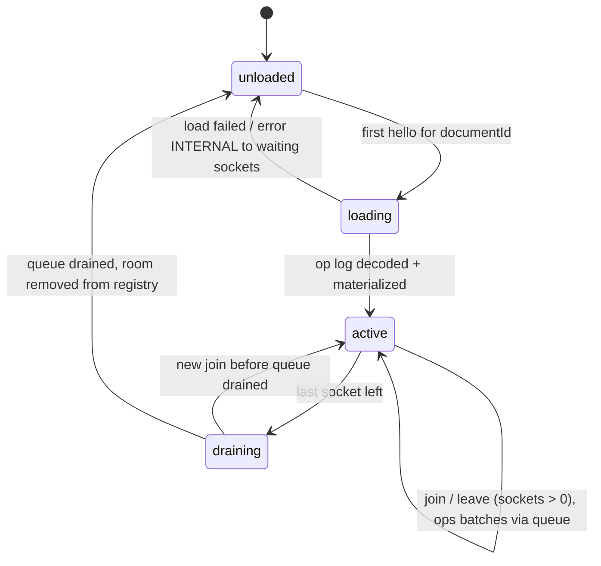
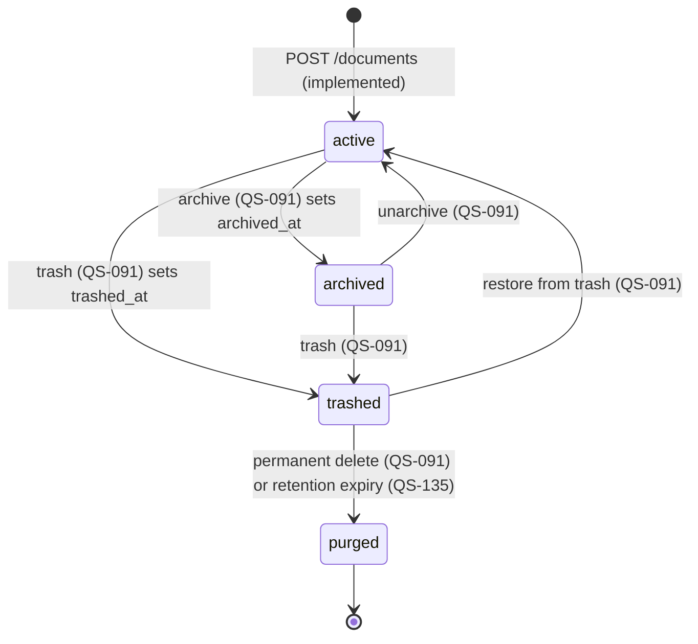
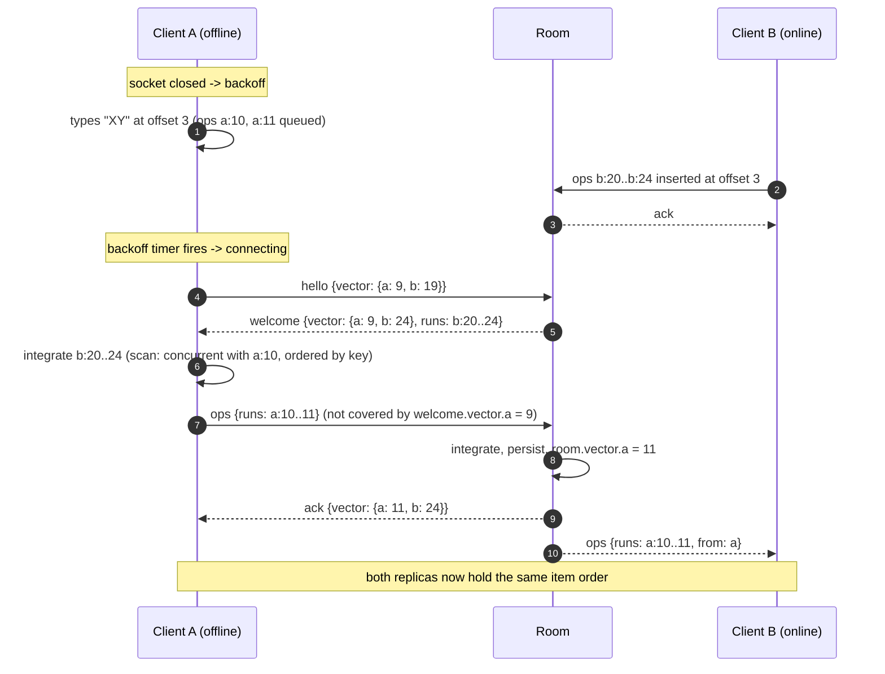
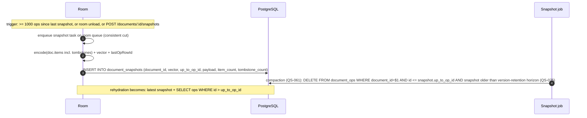

# System design

This document specifies the behaviour of quillsync's collaborative core: state machines, end-to-end sequences, the CRDT algorithms with pseudo-code and complexity, and the concurrency and consistency strategy. Architecture context: [../architecture/overview.md](../architecture/overview.md). Rationale for each choice: [../adr/README.md](../adr/README.md). Tables: [data-model.md](data-model.md).

Notation: n = number of items (visible + tombstones) in a document, k = number of ops in a batch, r = number of replicas (client ids) in a state vector. "Key" of an item = `(lamport, client)` compared lexicographically. Code paths refer to `packages/shared/src/crdt/*` unless stated otherwise.

---

## 1. Core data structures

```ts
type ClientId = string; // random per editor tab
type ItemId = { client: ClientId; seq: number }; // seq contiguous per client, starts at 1

type InsertOp = {
  kind: 'insert';
  id: ItemId;
  lamport: number;
  origin: ItemId | null;
  char: string;
};
type DeleteOp = { kind: 'delete'; id: ItemId; lamport: number; target: ItemId };
type Op = InsertOp | DeleteOp;

type Item = {
  id: ItemId;
  lamport: number;
  origin: ItemId | null;
  char: string;
  deleted: boolean;
  deletedBy: ItemId | null;
};

type StateVector = Record<ClientId, number>; // highest contiguous seq integrated per client

type InsertRun = { kind: 'insert'; client; seq; lamport; origin: ItemId | null; text: string };
type DeleteRun = {
  kind: 'delete';
  client;
  seq;
  lamport;
  targets: { client; from: number; to: number }[];
};

type CrdtDocument = {
  // immutable value
  items: readonly Item[]; // document order, tombstones included
  index: ReadonlyMap<string, number>; // "client:seq" -> position in items
  vector: StateVector;
  lamport: number; // local Lamport clock
  pending: PendingBuffer; // ops not yet causally ready
};
```

Both inserts and deletes consume a `seq` from their author, so a client's op stream `c:1, c:2, ...` is contiguous regardless of op kind.

---

## 2. State machines

### 2.1 Client connection lifecycle (`apps/web/src/collab`)

```mermaid
stateDiagram-v2
    [*] --> idle
    idle --> connecting: open(documentId)
    connecting --> syncing: socket open / send hello{clientId, vector, user}
    connecting --> backoff: socket error or close
    syncing --> live: welcome received / integrate runs, resend ops not covered by welcome.vector
    syncing --> backoff: close before welcome
    live --> live: local edit / enqueue + send ops
    live --> live: ops / integrate; ack / drop covered ops from outbound queue
    live --> backoff: close (network, server restart)
    backoff --> connecting: timer fires (0.5s doubling to 10s, with jitter)
    connecting --> closed: 401 / 403 / 404 on upgrade
    live --> closed: user leaves document
    backoff --> closed: user leaves document
    closed --> [*]
```



| State      | Outbound queue                                         | Local edits                       | Notes                                                                                  |
| ---------- | ------------------------------------------------------ | --------------------------------- | -------------------------------------------------------------------------------------- |
| idle       | empty                                                  | n/a                               | Before the editor mounts                                                               |
| connecting | retained                                               | accepted, applied locally, queued | Edits never block on the network                                                       |
| syncing    | retained                                               | accepted, queued                  | `hello` sent; waiting for `welcome`                                                    |
| live       | sent; entries removed when an `ack` vector covers them | sent immediately                  | Presence frames sent on caret move                                                     |
| backoff    | retained                                               | accepted, queued                  | Delay `min(10s, 0.5s * 2^attempt) * random(0.5, 1.0)`; attempt resets on reaching live |
| closed     | discarded (persisted to IndexedDB after QS-120)        | n/a                               | Terminal for auth and not-found errors                                                 |

### 2.2 Room lifecycle (`apps/api/src/modules/collab/room-registry.ts`, `room.ts`)



- `loading` is shared: concurrent joins for the same document await one load promise; the registry stores the promise, not the room, until it resolves.
- `draining` lets in-flight batches finish persist and ack before the room is dropped. A join during draining reuses the room.
- Planned: with QS-054 an `active` room additionally holds the document's advisory lock; losing the lock (connection drop) forces `unloaded`.

### 2.3 Document lifecycle



| State    | Editable              | Listed               | Sync socket                          | Storage                                                                            |
| -------- | --------------------- | -------------------- | ------------------------------------ | ---------------------------------------------------------------------------------- |
| active   | yes (role permitting) | yes                  | allowed                              | op log + snapshots                                                                 |
| archived | read-only             | in "Archived" filter | read-only (ops rejected `FORBIDDEN`) | retained                                                                           |
| trashed  | no                    | in "Trash" only      | refused                              | retained until purge                                                               |
| purged   | n/a                   | no                   | refused (`NOT_FOUND`)                | rows deleted: `document_ops`, snapshots, versions, comments, permissions (cascade) |

Only `active` exists today; `documents.archived_at` is already migrated, `trashed_at` is planned (see data model).

---

## 3. Sequences

### 3.1 Join and delta sync (implemented)

```mermaid
sequenceDiagram
    autonumber
    participant C as Client replica
    participant S as connection.ts
    participant RR as room-registry
    participant R as Room
    participant DB as PostgreSQL

    C->>S: hello {clientId: "k3f9", vector: {}}
    S->>RR: getOrLoad(docId)
    alt room unloaded
        RR->>DB: SELECT payload FROM document_ops WHERE document_id=$1 ORDER BY id
        DB-->>RR: rows
        RR->>R: decode each payload (codec) -> runs -> ops; materialize tree -> items
    end
    RR-->>S: room
    S->>R: join(socket, clientId, user)
    R->>R: delta = ops where seq > hello.vector[client] (per client), compressed to runs
    R-->>C: welcome {vector: room.vector, runs: delta, peers}
    R-->>R: broadcast presence {peer} to other sockets
    C->>C: applyRemote(doc, expand(runs)) (tree path if k > 32)
    C->>C: resend local ops with seq > welcome.vector[clientId]
```

A fresh client (empty vector) receives the whole document as runs; a reconnecting client receives only what it missed.

### 3.2 Local edit → ops → persist → ack → fan-out (implemented)

```mermaid
sequenceDiagram
    autonumber
    participant U as User
    participant T as textarea + diff.ts
    participant E as Sync engine
    participant R as Room (promise queue)
    participant DB as PostgreSQL
    participant P as Peer clients

    U->>T: types "hi" after "Hello "
    T->>T: diff(old, new) = {at: 6, delete: 0, insert: "hi"}
    T->>E: localInsert(doc, 6, "hi")
    E->>E: ops: k3f9:8 origin=item@5, k3f9:9 origin=k3f9:8; doc' committed locally
    E->>E: outbound.push(ops); compress -> 1 run
    E->>R: ops {runs}
    R->>R: enqueue task
    Note over R: task runs when previous task for this document resolves
    R->>R: candidate = applyRemote(room.doc, ops); integrated = newly integrated ops
    alt integrated is empty (duplicate)
        R-->>E: ack {vector}
    else
        R->>DB: INSERT INTO document_ops (... client_id, seq_start=8, seq_end=9, op_count=2, payload) ON CONFLICT DO NOTHING
        DB-->>R: committed
        R->>R: room.doc = candidate
        R-->>E: ack {vector: {..., k3f9: 9}}
        R-->>P: ops {runs, from: "k3f9"}
    end
    E->>E: drop outbound ops covered by ack.vector
    P->>P: applyRemote; re-render; restore local caret from anchor
```

### 3.3 Reconnect with offline edits (implemented in memory; IndexedDB QS-120)



### 3.4 Snapshot and compaction (planned QS-060, QS-061)



A client whose vector predates the oldest retained op row cannot be served a delta; it receives the snapshot instead (`welcome` with full runs) and, if it holds unacknowledged ops, resends them by id as usual.

### 3.5 GC frontier (planned QS-062, QS-063)

```mermaid
sequenceDiagram
    autonumber
    participant C1 as Replica c1
    participant C2 as Replica c2
    participant R as Room
    participant DB as PostgreSQL

    C1->>R: hello / ack-driven vector reports
    R->>DB: UPSERT document_replicas (document_id, client_id, ack_vector, last_seen_at)
    C2->>R: vector reports
    R->>DB: UPSERT document_replicas
    R->>R: stable = pointwise min over non-evicted replicas' ack vectors
    R->>R: any time: doc' = collectGarbage(doc, stable)
    R->>R: at snapshot time, if stable covers room.vector and nothing pending: doc' = compactStable(doc', stable)
    R->>DB: INSERT document_snapshots (payload of doc', gc_vector = stable)
    Note over R: replicas joining after compaction start from this snapshot, not the op log
    R->>DB: QS-063: replicas with last_seen_at older than eviction window -> evicted_at = now()
    Note over C2: an evicted replica reconnecting is resynced from snapshot; its unacked ops are rebased as new local ops on the fresh state
```

---

## 4. Core algorithms

### 4.1 RGA scan integration

`integrate.ts`. Integrate a causally ready insert `op` into `items`:

```
function integrateInsert(items, index, op):
    i = (op.origin == null) ? 0 : index[op.origin] + 1
    while i < len(items):
        other = items[i]
        if key(other) > key(op):          # (lamport, client) lexicographic
            i = i + 1                      # skip: greater sibling or a descendant of one
        else:
            break                          # first item with smaller key: insert before it
    return insertAt(items, i, toItem(op))  # copy-on-write; rebuild index entries >= i

function integrateDelete(items, index, op):
    j = index[op.target]
    if items[j].deleted: return items      # concurrent deletes of the same item commute
    return replaceAt(items, j, { ...items[j], deleted: true, deletedBy: op.id })
```

Complexity: O(n) per insert (scan plus array copy and index shift); O(1) lookup plus O(n) copy per delete.

**Proof sketch: why the scan stops at the right place.** Define the timestamp tree: each item's parent is its origin (the virtual root for `null`); siblings are ordered by key descending; document order is the pre-order traversal. Claim: the scan inserts `op` exactly where pre-order places it, namely after its origin O, after all of O's children with a greater key and their whole subtrees, and before the first child with a smaller key.

1. _Descendants dominate ancestors._ An item's origin was visible to its creator, so the creator had integrated the origin and its Lamport clock exceeded the origin's lamport. Hence lamport(child) > lamport(parent), and by induction every descendant's key is greater than every ancestor's key.
2. _Greater siblings' subtrees are skipped in full._ If sibling S of `op` has key(S) > key(op), every descendant D of S satisfies key(D) > key(S) > key(op) by (1). Pre-order lays out S's subtree contiguously, so the scan skips all of it.
3. _The scan stops at a smaller sibling._ The first sibling S' with key(S') < key(op) is not skipped; the scan stops before it, which is its pre-order position.
4. _The scan never leaves O's subtree wrongly._ If no smaller sibling exists, the first item after O's subtree is some X that is a later sibling of O or of an ancestor A of O. Siblings are descending, so key(X) < key(A) <= key(O) < key(op) (the last step by (1), since `op` is a child of O). The scan stops at X: `op` becomes the last item of O's subtree, which is again its pre-order position.

Since pre-order of the tree is a deterministic function of the set of items, any two replicas that integrated the same set of ops, in any causally valid order, hold identical sequences. Deletes only flip a flag and commute.

### 4.2 Timestamp-tree materialization

`materialize.ts`. Used for rehydration and for remote batches with k > 32.

```
function materialize(allInsertItems, deletedSet):
    children = map ItemId|ROOT -> list
    for item in allInsertItems:                         # O(n)
        children[item.origin ?? ROOT].append(item)
    for list in children.values():
        sort list by key descending                     # O(n log n) total
    out = []
    stack = reverse(children[ROOT])
    while stack not empty:                              # iterative pre-order DFS, O(n)
        item = stack.pop()
        out.append({ ...item, deleted: item.id in deletedSet })
        stack.pushAll(reverse(children[item.id]))
    return out
```

Complexity O(n log n) time, O(n) space; iterative to avoid stack overflow on long single-author chains (a typed paragraph is a chain of depth equal to its length).

**Equivalence.** Section 4.1 shows scan integration produces the pre-order of the same tree; materialization computes that pre-order directly. `convergence.property.test.ts` and `materialize.test.ts` assert `scanAll(ops) == materialize(ops)` on random histories (QA-CONV-2). For a batch merge, the existing items plus the batch's ready inserts form the item set; the causal buffer (4.3) is applied first so only ready ops enter the tree.

### 4.3 Causal readiness buffer

`document.ts`.

```
function isReady(doc, op):
    if op.id.seq != (doc.vector[op.id.client] ?? 0) + 1: return false
    if op.kind == 'insert': return op.origin == null or op.origin in doc.index
    else:                   return op.target in doc.index

function receive(doc, ops):
    integrated = []
    work = queue(ops)
    while work not empty:
        op = work.pop()
        if op.id.seq <= (doc.vector[op.id.client] ?? 0): continue     # duplicate: drop
        if not isReady(doc, op):
            doc.pending.add(op, waitingOn = missingDependency(doc, op)); continue
        doc = integrate(doc, op)
        doc.vector[op.id.client] = op.id.seq
        doc.lamport = max(doc.lamport, op.lamport)
        integrated.append(op)
        work.pushAll(doc.pending.release(op.id))     # ops waiting on this id
        work.pushAll(doc.pending.release(nextSeqKey(op.id.client)))
    return { doc, integrated }
```

The pending buffer is keyed by the missing dependency (`"client:seq"` for origin/target, or `"client:next"` for a seq gap), so each wake-up is O(1) amortized and every buffered op is examined O(1) times per dependency it waits on. `receive` is total: it never throws on out-of-order or duplicate input. Ops that remain pending after a batch indicate a gap that the reconnect handshake repairs (ADR-0008).

### 4.4 Run-length compression

`runs.ts`.

```
function compress(ops):                         # ops in seq order per client
    runs = []
    for op in ops:
        last = runs.peek()
        if op.kind == 'insert' and last?.kind == 'insert'
           and op.id.client == last.client
           and op.id.seq == last.seq + len(last.text)
           and op.lamport == last.lamport + len(last.text)
           and op.origin == { client: last.client, seq: last.seq + len(last.text) - 1 }:
            last.text += op.char                       # (built immutably in the implementation)
        elif op.kind == 'delete' and last?.kind == 'delete'
           and op.id.client == last.client and op.id.seq == last.seq + count(last)
           and op.lamport == last.lamport + count(last):
            appendTarget(last.targets, op.target)      # extends {client, from, to} if contiguous
        else:
            runs.push(newRun(op))
    return runs

function expand(run):   # inverse; item i of an insert run:
    id = {run.client, run.seq + i}, lamport = run.lamport + i,
    origin = (i == 0) ? run.origin : {run.client, run.seq + i - 1}, char = codePoints(run.text)[i]
```

Both directions are O(k). `expand(compress(ops)) == ops` is a property test in `runs.test.ts`. Runs iterate text by code point, never by UTF-16 unit, so surrogate pairs stay in one item.

### 4.5 Varint binary codec

`codec.ts`. Logical layout of an encoded batch (byte-level details are authoritative in the source):

```
batch      := clientDict runCount run*
clientDict := varint(count) (varint(byteLen) utf8Bytes)*
run        := kindTag varint(clientIdx) varint(seq) varint(lamport) body
insertBody := originTag [varint(originClientIdx) varint(originSeq)] varint(byteLen) utf8Bytes
deleteBody := varint(rangeCount) (varint(targetClientIdx) varint(from) varint(to - from))*
```

Unsigned LEB128: 7 payload bits per byte, high bit = continuation.

```
function writeVarint(buf, v):          # v is a non-negative safe integer
    while v >= 0x80: buf.push((v & 0x7f) | 0x80); v = floor(v / 128)
    buf.push(v)

function readVarint(bytes, pos):
    result = 0; shift = 0
    loop:
        if pos >= len(bytes):           throw CodecError("truncated varint")
        b = bytes[pos++]
        result += (b & 0x7f) * 2^shift
        if result > MAX_SAFE_INTEGER:   throw CodecError("varint overflow")
        if (b & 0x80) == 0: return (result, pos)
        shift += 7
        if shift > 49:                  throw CodecError("varint too long")
```

Strictness rules, all throwing `CodecError`: truncated input, varints beyond the safe-integer range, client index outside the dictionary, declared byte length past the end of the buffer, invalid UTF-8 (decoded with a fatal decoder), unknown kind tags, `to < from`, trailing bytes after the last run. Encode and decode are O(size). `codec.test.ts` round-trips random batches and fuzzes random and mutated byte arrays to confirm that decoding either succeeds with a valid batch or throws `CodecError`, never anything else. Varint encoding makes small seq/lamport deltas and dictionary indexes one byte each.

### 4.6 Tombstone garbage collection

`gc.ts` (library implemented, server wiring of both functions pending QS-062). The library has **two** GC functions, because the childless rule alone collects little during normal typing: each typed character's origin is the previous character, so a run deleted in the middle of a paragraph is usually an _ancestor_ of live text typed after it, and ancestors are never childless.

| Function                      | When it may run                                                                                                   | What it collects                                                                                            | Cost                         |
| ----------------------------- | ----------------------------------------------------------------------------------------------------------------- | ----------------------------------------------------------------------------------------------------------- | ---------------------------- |
| `collectGarbage(doc, stable)` | Any time                                                                                                          | Tombstones whose delete is stable and that have no retained children: deleted tails, whole deleted subtrees | O(n), one right-to-left pass |
| `compactStable(doc, stable)`  | Only when the whole document is causally stable: `stable` covers the local vector and the pending buffer is empty | **All** tombstones; live items are re-chained (each origin := its predecessor)                              | O(n)                         |

#### 4.6.1 Incremental childless rule: `collectGarbage`

```
function stableVector(ackVectors):            # pointwise min over all non-evicted replicas
    clients = union of keys
    return { c: min(v[c] ?? 0 for v in ackVectors) for c in clients }

function gc(doc, stable):
    retainedChildren = counter ItemId -> int
    for item in doc.items: if item.origin != null: retainedChildren[item.origin] += 1
    out = []
    for i from len(doc.items) - 1 downto 0:            # right to left
        item = doc.items[i]
        collectable = item.deleted
                      and item.deletedBy.seq <= (stable[item.deletedBy.client] ?? 0)
                      and retainedChildren[item.id] == 0
        if collectable:
            if item.origin != null: retainedChildren[item.origin] -= 1
        else:
            out.prepend(item)
    return { ...doc, items: out, index: rebuild(out) }
```

O(n) time and space. Right-to-left order works because in pre-order every child appears to the right of its parent, so when the pass reaches a parent all its children have already been decided.

**Proof sketch (childless rule).** Let T be a tombstone whose delete d is causally stable at the server and that has no retained children.

1. _No future child._ A new insert can name T as origin only if T was visible to its creator, i.e. the creator had not yet integrated d. Stability means every non-evicted replica's acknowledged vector covers d, and acknowledged vectors are reported only after the server has integrated everything they cover from that replica; any op a replica created before integrating d precedes d in that replica's own seq order and has therefore already reached the server. If it named T, T would have a child. New replicas start from server state that contains d. Hence T can never gain a child.
2. _Removal preserves order._ T is a leaf of the timestamp tree. Removing a leaf does not change the relative pre-order of any other item.
3. _Future scans are unaffected._ Any future insert is causally after d, so its lamport exceeds lamport(d) > lamport(T). In the scan, T would be a stopping point (smaller key) or lie outside the scanned region; removing it moves the stopping point at most to T's right neighbour, and since T is invisible and has no subtree, the resulting visible text and the pre-order of all retained items are identical.

Evicted replicas (QS-063) are excluded from the minimum and must resync from a snapshot, which is what makes the frontier advance when a replica disappears.

#### 4.6.2 Quiescent compaction: `compactStable`

```
function compactStable(doc, stable):
    if not covers(stable, doc.vector) or not doc.pending.isEmpty():
        return doc                                    # not quiescent: no-op
    live = [item for item in doc.items if not item.deleted]
    out = []
    prev = null
    for item in live:                                 # re-chain in document order
        out.append({ ...item, origin: prev })         # origin := predecessor (null for the first)
        prev = item.id
    return { ...doc, items: out, index: rebuild(out) }
```

O(n) time and space.

**Proof sketch.**

1. _Every future op is larger than every stored item._ Quiescence means every non-evicted replica has acknowledged every op the document contains. Any op created from now on is created by a replica that has integrated all of them, so its Lamport stamp exceeds the lamport of every stored item (and of every delete).
2. _A future insert lands immediately after its origin._ In the scan of section 4.1, the item directly right of the origin is either a stored item (smaller key, so the scan stops) or a future item, which is ordered against the new op by the ordinary rule. The stored items between two visible neighbours, tombstones included, therefore never affect where a future op lands, and neither do the stored items' original origins.
3. _Dropping tombstones is safe._ Future ops cannot name a tombstone as origin, since none is visible to any replica that can still create ops. A future delete targets a visible item, which is kept.
4. _Re-chaining keeps materialization consistent._ With origin := predecessor the live items form a single chain whose pre-order is exactly the current visible order, so `materialize` (section 4.2) reproduces the document. Future items attach below their (visible) origins in both the compacted and the uncompacted tree. By (2) they sort the same way in both, because every stored item has a smaller key.

Consequences for the protocol:

- A compacted replica keeps item **ids** but changes their **origins**, so its state can no longer be rebuilt by replaying the op log. Replicas that join after compaction must start from a snapshot (QS-060, QS-061), not from `document_ops`. In practice the server compacts only at snapshot time and serves that snapshot in `welcome` to replicas whose vectors predate it.
- Compacted and uncompacted replicas converge after further concurrent edits. Randomized tests in `gc.test.ts` check this: one replica compacts, all replicas keep editing concurrently, and their visible texts must match after full exchange.
- Anchors that point at a dropped tombstone need remapping first (QS-081).

`collectGarbage` is the safe default while editing is in progress. `compactStable` is the one that bounds tombstone growth in documents with long editing histories.

### 4.7 Anchor resolution

`anchors.ts`.

```
function anchorAt(doc, offset):                # caret between visible chars offset-1 and offset
    if offset == 0: return null
    return visibleItemAt(doc, offset - 1).id   # O(n) walk counting visible items

function resolve(doc, anchor):                 # -> offset
    if anchor == null: return 0
    j = doc.index[anchor]
    if j is undefined: return fallback(anchor) # collected by GC: QS-081 remaps before collection
    return countVisible(doc.items[0 .. j])     # inclusive of j if visible; tombstone -> chars left of it
```

O(1) lookup plus O(n) count; O(log n) with the order-statistic tree (QS-043). Because the anchor names the character to the _left_, text inserted at the caret by a peer appears to the right of the local caret only if the peer's item sorts after the anchor; text typed by the anchor owner always extends after it, matching user expectation. Presence frames carry `{anchor, focused}`; the web overlay calls `resolve` after every remote batch. Comment ranges (QS-080) store a start and an end anchor.

### 4.8 Prefix/suffix text diff

`text/diff.ts`.

```
function diff(old, new):                       # both as arrays of code points
    p = 0
    while p < len(old) and p < len(new) and old[p] == new[p]: p++
    s = 0
    while s < len(old) - p and s < len(new) - p
          and old[len(old)-1-s] == new[len(new)-1-s]: s++
    return { at: p, deleteCount: len(old) - p - s, insert: new[p .. len(new)-s] }
```

O(n) time, O(1) extra space beyond the code point arrays. The suffix loop is bounded by `len - p` so prefix and suffix never overlap. The result maps to at most one delete run (items at visible offsets `at .. at+deleteCount-1`) followed by one insert run with origin = visible item at `at - 1`. Covered by `diff.test.ts` (insert, delete, replace, repeated characters, surrogate pairs, empty strings).

### 4.9 Complexity summary

| Operation                                     | Current                     | After QS-043                  |
| --------------------------------------------- | --------------------------- | ----------------------------- |
| Local insert/delete of m chars                | O(n + m)                    | O(m log n)                    |
| Remote batch, k <= 32                         | O(k·n) scan                 | O(k log n)                    |
| Remote batch, k > 32 / rehydration            | O((n + k) log(n + k)) tree  | same                          |
| Delta for a vector                            | O(n) filter + O(k) compress | O(k) with per-client op index |
| Encode / decode                               | O(bytes)                    | same                          |
| GC pass (`collectGarbage` or `compactStable`) | O(n)                        | O(n)                          |
| Anchor resolve                                | O(n)                        | O(log n)                      |

---

## 5. Concurrency and consistency strategy

### 5.1 Per-room promise queue

```
class Room:
    queue = Promise.resolve()
    enqueue(task): this.queue = this.queue.then(task).catch(logAndContinue); return the task's promise
```

Every state-changing action for a document (ops batch, snapshot, GC, unload check) is a task on its room's queue. Node.js is single-threaded, but `await` points inside a task (the database insert) would otherwise let another batch observe a half-applied state. The queue makes each task atomic with respect to the room. Rooms for different documents run concurrently. Queue depth and wait time are planned metrics (QS-130); backpressure on deep queues is QS-052.

### 5.2 Persist before ack

Order inside a batch task: integrate into a candidate document (immutable, ADR-0015) → compute newly integrated ops → `INSERT` one `document_ops` row → on commit assign `room.doc = candidate` → `ack` to sender → `ops` to peers. If the insert fails, the candidate is discarded, the sender receives `error {code: INTERNAL}`, and its ops remain in its outbound queue. Thus every acked or fanned-out op is durable (ADR-0021).

### 5.3 Idempotency and at-least-once delivery

Three layers make duplicates harmless:

1. **Replica vector:** `seq <= vector[client]` → drop (both client and server).
2. **Persist only newly integrated ops:** a resend overlapping already-integrated ops persists only the new suffix, with its own `seq_start`.
3. **Database:** `UNIQUE(document_id, client_id, seq_start)` with `ON CONFLICT DO NOTHING` catches races (two nodes during QS-054 failover, or a retry after an ambiguous commit).

Clients resend everything not covered by the server's vector on every reconnect; the server's `welcome` delta re-sends everything not covered by the client's vector. Delivery is at-least-once in both directions; integration is exactly-once.

### 5.4 Convergence argument

1. Every replica integrates the same set of ops eventually: the server persists every op it acks, every reconnect exchanges vector-based deltas both ways, and the causal buffer guarantees that a received op is integrated once its dependencies arrive.
2. The document state is a function of the op set alone: inserts determine the timestamp tree, whose pre-order is unique (section 4.1); deletes set a flag that is idempotent and commutative.
3. Scan integration and tree materialization compute the same pre-order (section 4.2), so mixing paths across replicas is safe.
4. GC removes only items whose removal does not change the visible text or the order of retained items. `collectGarbage` removes childless stable tombstones. `compactStable` runs only under full causal stability, when every future op sorts after every stored item, so dropping tombstones and re-chaining origins cannot change where future ops land (section 4.6).

Therefore replicas that have integrated the same op set have identical text (strong eventual consistency). This is checked empirically by the seeded property harness (QS-027) and the two-client integration test in `collab-sync.test.ts`.

### 5.5 Failure modes

| Failure                                     | Detection                      | Effect                                                                     | Recovery                                                         |
| ------------------------------------------- | ------------------------------ | -------------------------------------------------------------------------- | ---------------------------------------------------------------- |
| Client network drop                         | socket `close`                 | Client enters backoff; edits continue locally                              | Reconnect handshake; resend unacked ops                          |
| Server process crash                        | clients see `close`            | Live rooms lost; unacked batches not persisted                             | Rooms rehydrate from op log on next join; clients resend         |
| Database insert fails                       | query error in room task       | Candidate discarded, `error INTERNAL` to sender                            | Client resends on next reconnect or retry                        |
| Database unavailable at load                | load promise rejects           | Room returns to `unloaded`; joining sockets get `error INTERNAL` and close | Client backoff retries; `/api/ready` fails for operators         |
| Malformed frame                             | zod parse failure              | `error VALIDATION_ERROR`; frame ignored                                    | None needed                                                      |
| Oversized frame                             | exceeds `WS_MAX_MESSAGE_BYTES` | Socket closed by ws                                                        | Client reconnects; should split batches                          |
| Read-only role sends ops                    | role check                     | `error FORBIDDEN`; ops ignored                                             | UI disables editing for viewer/commenter                         |
| Op with missing dependency                  | causal buffer                  | Op waits in pending                                                        | Dependency arrives later or reconnect fills gap                  |
| Corrupted payload row                       | `CodecError` on rehydration    | Room load fails                                                            | Restore from backup (QS-064); planned snapshot fallback (QS-060) |
| Long-offline replica                        | GC frontier stalls             | Tombstones accumulate                                                      | QS-063 eviction and resync from snapshot                         |
| Permission revoked while connected          | not detected today             | Socket keeps prior role until reconnect                                    | QS-056 re-authorization                                          |
| Two nodes own one room (planned multi-node) | advisory lock                  | Duplicate integration attempts                                             | Unique constraint dedupes rows; CRDT dedupes ops                 |
