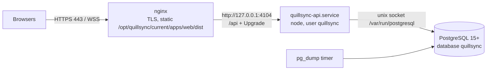

# Deployment

How to deploy quillsync to a single Linux VM or bare-metal host: native Node.js API under systemd, nginx serving the built web client and reverse-proxying `/api` (including WebSocket upgrades), and a native PostgreSQL. No Docker, no containers, no orchestrator. Scripted versions of these steps and TLS hardening are tracked as QS-137.

See also: [runbook.md](runbook.md) for configuration, health checks and troubleshooting; [../security/threat-model.md](../security/threat-model.md) for the controls this layout provides; [../architecture/overview.md](../architecture/overview.md) for the component view.

## Topology



### Single-node constraint

Collaboration rooms are in-memory, one per document per process. Two API processes would each hold their own room for the same document, and edits made through one would not reach sockets on the other until a reload. Until multi-node fan-out (QS-053, LISTEN/NOTIFY) and sticky room ownership (QS-054, advisory locks) land:

- run exactly **one** API process per database;
- do not put two API hosts behind a load balancer;
- scale vertically (CPU, memory) and keep `DB_POOL_MAX` sized for one process.

## Host prerequisites

| Component                    | Version                                              | Notes                                                         |
| ---------------------------- | ---------------------------------------------------- | ------------------------------------------------------------- |
| Linux                        | Debian 12 / Ubuntu 22.04+ or equivalent with systemd |                                                               |
| Node.js                      | ≥ 22                                                 | From the distribution or NodeSource packages; `/usr/bin/node` |
| PostgreSQL                   | ≥ 15                                                 | Distribution packages                                         |
| nginx                        | ≥ 1.22                                               |                                                               |
| certbot or other ACME client | any                                                  | TLS certificates                                              |

```bash
sudo useradd --system --home /opt/quillsync --shell /usr/sbin/nologin quillsync
sudo mkdir -p /opt/quillsync/releases /etc/quillsync /var/backups/quillsync
sudo chown quillsync:quillsync /opt/quillsync/releases
sudo chmod 750 /var/backups/quillsync && sudo chown postgres:postgres /var/backups/quillsync
```

## PostgreSQL setup

```bash
sudo -u postgres createuser --no-superuser --no-createdb --no-createrole quillsync
sudo -u postgres createdb --owner quillsync quillsync
```

- Connect over the unix socket with peer authentication: the `quillsync` OS user maps to the `quillsync` role, so no password is stored. In `pg_hba.conf`: `local   quillsync   quillsync   peer`.
- Keep `listen_addresses = 'localhost'` (or `''`) in `postgresql.conf`; the database is never exposed on the network.
- `DATABASE_URL=postgres:///quillsync?host=/var/run/postgresql`.

## Build artifacts

Build on a CI runner or a build host with the same Node major version, from a tagged commit:

```bash
git checkout v0.3.0
npm ci
npm run lint && npm run typecheck && npm test
npm run build
npm prune --omit=dev
tar czf quillsync-v0.3.0.tar.gz package.json package-lock.json node_modules \
  packages/shared/package.json packages/shared/dist \
  apps/api/package.json apps/api/dist apps/api/migrations \
  apps/web/dist
```

| Artifact               | Contents                                           | Served by           |
| ---------------------- | -------------------------------------------------- | ------------------- |
| `packages/shared/dist` | CRDT, protocol schemas, RBAC (compiled)            | imported by the API |
| `apps/api/dist`        | Fastify server and the migration CLI (`db/cli.js`) | systemd             |
| `apps/api/migrations`  | Forward-only SQL files                             | migration CLI       |
| `apps/web/dist`        | Static HTML/JS/CSS from Vite                       | nginx               |

Run the Playwright smoke and collaboration specs locally against the build before tagging (they are not part of CI; see [../testing/test-strategy.md](../testing/test-strategy.md)).

## Environment file

`/etc/quillsync/api.env`, owned `root:quillsync`, mode `0640` (the service can read it, other users cannot):

```ini
NODE_ENV=production
API_HOST=127.0.0.1
API_PORT=4104
APP_ORIGIN=https://docs.example.org
DATABASE_URL=postgres:///quillsync?host=/var/run/postgresql
SESSION_SECRET=<output of: openssl rand -base64 48>
SESSION_TTL_HOURS=168
LOG_LEVEL=info
# nginx on the same host is the only proxy; required in production.
TRUST_PROXY=127.0.0.1
LOGIN_EMAIL_FREE_ATTEMPTS=5
LOGIN_IP_RATE_LIMIT_MAX=30
LOGIN_EMAILS_PER_IP_MAX=20
REGISTER_IP_RATE_LIMIT_MAX=5
WS_MAX_MESSAGE_BYTES=262144
DB_POOL_MAX=10
```

```bash
sudo install -o root -g quillsync -m 0640 api.env /etc/quillsync/api.env
```

`TRUST_PROXY` must be set explicitly in production (the API refuses to start otherwise): use the proxy address (`127.0.0.1`) or a hop count (`1`) so the client IP used for throttling and audit comes from nginx's `X-Forwarded-For`; never trust arbitrary forwarders. Throttle counters are in process memory, which is one more reason to run a single API instance until QS-053 moves them to PostgreSQL.

`NODE_ENV=production` makes `qs_session` `Secure`, so the site must be served over HTTPS. `APP_ORIGIN` must be the exact public origin; otherwise every WebSocket upgrade is refused with 403.

## systemd unit

`/etc/systemd/system/quillsync-api.service`:

```ini
[Unit]
Description=quillsync API (HTTP + WebSocket sync)
After=network.target postgresql.service
Requires=postgresql.service

[Service]
Type=simple
User=quillsync
Group=quillsync
WorkingDirectory=/opt/quillsync/current
EnvironmentFile=/etc/quillsync/api.env
ExecStart=/usr/bin/node apps/api/dist/index.js
Restart=on-failure
RestartSec=2
TimeoutStopSec=20
KillSignal=SIGTERM
LimitNOFILE=65536
MemoryMax=2G

# Hardening
NoNewPrivileges=true
ProtectSystem=strict
ProtectHome=true
PrivateTmp=true
PrivateDevices=true
ProtectKernelTunables=true
ProtectKernelModules=true
ProtectControlGroups=true
RestrictAddressFamilies=AF_UNIX AF_INET AF_INET6
RestrictNamespaces=true
LockPersonality=true
SystemCallArchitectures=native
ReadOnlyPaths=/opt/quillsync

[Install]
WantedBy=multi-user.target
```

`apps/api/dist/index.js` is the tsup bundle (the shared package is bundled in); `apps/api/dist/db/cli.js migrate|seed|reset` is the migration CLI. On SIGTERM the API closes its listeners and sockets; clients reconnect with backoff and resend any ops that were not acked, so a batch interrupted mid-persist is not lost (the `document_ops` unique key makes the resend idempotent).

```bash
sudo systemctl daemon-reload
sudo systemctl enable --now quillsync-api
```

## nginx

`/etc/nginx/sites-available/quillsync`:

```nginx
map $http_upgrade $connection_upgrade {
    default upgrade;
    ''      close;
}

upstream quillsync_api {
    server 127.0.0.1:4104;
    keepalive 16;
}

server {
    listen 80;
    listen [::]:80;
    server_name docs.example.org;
    return 301 https://$host$request_uri;
}

server {
    listen 443 ssl;
    listen [::]:443 ssl;
    http2 on;
    server_name docs.example.org;

    ssl_certificate     /etc/letsencrypt/live/docs.example.org/fullchain.pem;
    ssl_certificate_key /etc/letsencrypt/live/docs.example.org/privkey.pem;
    ssl_protocols TLSv1.2 TLSv1.3;
    ssl_prefer_server_ciphers off;
    ssl_session_cache shared:SSL:10m;
    add_header Strict-Transport-Security "max-age=31536000; includeSubDomains" always;
    add_header X-Content-Type-Options nosniff always;
    add_header Referrer-Policy same-origin always;

    root /opt/quillsync/current/apps/web/dist;
    client_max_body_size 2m;

    # WebSocket sync: must come before the generic /api/ block
    location ~ ^/api/v1/documents/[^/]+/sync$ {
        proxy_pass http://quillsync_api;
        proxy_http_version 1.1;
        proxy_set_header Upgrade $http_upgrade;
        proxy_set_header Connection $connection_upgrade;
        proxy_set_header Host $host;
        proxy_set_header Origin $http_origin;
        proxy_set_header X-Forwarded-For $proxy_add_x_forwarded_for;
        proxy_set_header X-Forwarded-Proto $scheme;
        proxy_read_timeout 1h;
        proxy_send_timeout 1h;
        proxy_buffering off;
    }

    location /api/metrics {
        allow 127.0.0.1;
        deny all;
        proxy_pass http://quillsync_api;
    }

    location /api/ {
        proxy_pass http://quillsync_api;
        proxy_http_version 1.1;
        proxy_set_header Connection "";
        proxy_set_header Host $host;
        proxy_set_header X-Forwarded-For $proxy_add_x_forwarded_for;
        proxy_set_header X-Forwarded-Proto $scheme;
    }

    location /assets/ {
        expires 1y;
        add_header Cache-Control "public, immutable";
    }

    # SPA routes (React Router)
    location / {
        try_files $uri /index.html;
        add_header Cache-Control "no-cache";
    }
}
```

```bash
sudo ln -s /etc/nginx/sites-available/quillsync /etc/nginx/sites-enabled/
sudo nginx -t && sudo systemctl reload nginx
```

The web client and API share one origin, so `APP_ORIGIN=https://docs.example.org` and the browser sends that exact `Origin` on WebSocket upgrades. A Content-Security-Policy header is added with QS-132.

## TLS

- Obtain certificates with `sudo certbot --nginx -d docs.example.org` (or `certbot certonly --webroot`), and confirm the renewal timer: `systemctl list-timers | grep certbot`.
- TLS 1.2 and 1.3 only; HSTS enabled once HTTPS is confirmed working.
- The API and PostgreSQL never terminate TLS themselves; both listen on loopback / unix socket only.

## Backups

Nightly custom-format dump via a systemd timer running as `postgres`:

```ini
# /etc/systemd/system/quillsync-backup.service
[Service]
Type=oneshot
User=postgres
ExecStart=/bin/sh -c 'pg_dump --format=custom --file /var/backups/quillsync/quillsync-$(date -u +%%Y%%m%%dT%%H%%M%%SZ).dump quillsync && find /var/backups/quillsync -name "*.dump" -mtime +14 -delete'

# /etc/systemd/system/quillsync-backup.timer
[Timer]
OnCalendar=*-*-* 02:30:00
Persistent=true
[Install]
WantedBy=timers.target
```

Copy dumps off the host (encrypted). Restore steps are in [runbook.md](runbook.md#backup-and-restore); automated round-trip verification is QS-064.

## Release procedure

Releases live in `/opt/quillsync/releases/<version>`; `/opt/quillsync/current` is a symlink to the active one.

1. **Pre-flight**: CI green on the tag; Playwright smoke + collaboration passed locally; read new migration files in the release.
2. **Upload and unpack**:
   ```bash
   sudo -u quillsync mkdir /opt/quillsync/releases/v0.3.0
   sudo -u quillsync tar xzf quillsync-v0.3.0.tar.gz -C /opt/quillsync/releases/v0.3.0
   ```
3. **Back up**: `sudo systemctl start quillsync-backup.service` and confirm a new dump exists.
4. **Migrate before switching** (the old release keeps serving while this runs):
   ```bash
   cd /opt/quillsync/releases/v0.3.0
   sudo -u quillsync sh -c 'set -a; . /etc/quillsync/api.env; set +a; exec node apps/api/dist/db/cli.js migrate'
   ```
   Migrations must be backward compatible with the running release (expand first: add tables/columns/indexes; remove only in a later release). The runner verifies checksums of already-applied files and aborts on mismatch.
5. **Switch**:
   ```bash
   sudo ln -sfn /opt/quillsync/releases/v0.3.0 /opt/quillsync/current
   sudo systemctl restart quillsync-api
   sudo systemctl reload nginx
   ```
   Editors see a brief "reconnecting"; their clients resend unacked ops after reconnect, so no edits are lost while tabs stay open.
6. **Verify**: `curl -fsS https://docs.example.org/api/ready`; `journalctl -u quillsync-api -n 50 -o cat`; open one document in two browsers and confirm edits converge.
7. **Clean up**: keep the previous two releases; delete older ones.

## Rollback

Migrations are forward-only: there are no down migrations.

| Situation                                                                                        | Action                                                                                                                                                                                                                                                                                                                                                                                                                             |
| ------------------------------------------------------------------------------------------------ | ---------------------------------------------------------------------------------------------------------------------------------------------------------------------------------------------------------------------------------------------------------------------------------------------------------------------------------------------------------------------------------------------------------------------------------- |
| New code is broken, release had no migrations or only backward-compatible ones (the normal case) | Point `current` back to the previous release and `systemctl restart quillsync-api`. The previous code runs fine on the expanded schema.                                                                                                                                                                                                                                                                                            |
| Bug in a migration or data damaged by the new release                                            | **Roll forward**: ship a fix release with a new corrective migration. Preferred over restore because it loses no edits.                                                                                                                                                                                                                                                                                                            |
| Data loss or corruption that cannot be corrected forward                                         | Stop the API, restore the pre-release dump into a new database ([runbook.md](runbook.md#backup-and-restore)), point `DATABASE_URL` at it, start the previous release. Every edit made after the dump is lost from the server; browsers still open on a document may resend ops they still hold in their outbound queue when they reconnect, which recovers some of their own recent edits. Announce the data-loss window to users. |

Never edit an applied migration file to "undo" it: the checksum check will stop the API from starting.

## Post-deploy checks

- `/api/health` and `/api/ready` return 200 through nginx.
- The WebSocket check from [runbook.md](runbook.md#health-checks) returns 401 through `https://docs.example.org` (upgrade forwarded, no session), not 400/404/502.
- `qs_session` arrives with `Secure; HttpOnly; SameSite=Lax`.
- `ss -ltnp` shows only nginx on 80/443; node on `127.0.0.1:4104`; PostgreSQL not on a public interface.
- `/etc/quillsync/api.env` is `0640 root:quillsync`.
