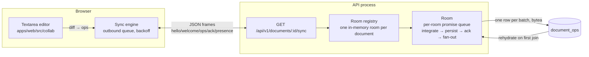

# Implementation status

**Overall: 128 of 1156 estimated hours done, which is 11.1 %.** 28 of 99 tickets are done.

This page is derived from [backlog.md](backlog.md), which is the source of truth. Requirement IDs refer to [../product/requirements.md](../product/requirements.md). Milestone plans are in [roadmap.md](roadmap.md).

## Method

1. Each backlog ticket has an estimate in engineering hours (tests and documentation included) and a status of `done` or `pending`. No partial credit is given: a ticket counts as done only when it is merged, tested and running in CI.
2. **Epic completion = sum of hours of done tickets in the epic ÷ sum of hours of all tickets in the epic.**
3. **Overall completion = 128 h done ÷ 1156 h total = 11.07 %**, rounded to **11.1 %**.
4. Percentages are weighted by hours rather than ticket counts, because tickets range from 2 h (QS-004) to 56 h (QS-050). By ticket count the project is 28/99 = 28.3 % done, which overstates progress: the done tickets are the small foundation and core tickets.
5. Recompute whenever a ticket's status or estimate changes in the backlog, and update this page in the same change.

## Completion by epic

| Epic      | Name                               | Tickets (done/total) | Hours done | Hours total |   Complete |
| --------- | ---------------------------------- | -------------------: | ---------: | ----------: | ---------: |
| E0        | Foundation                         |                8 / 8 |         31 |          31 |    100.0 % |
| E1        | Identity & access                  |               5 / 12 |         20 |          82 |     24.4 % |
| E2        | CRDT core                          |               8 / 16 |         42 |         274 |     15.3 % |
| E3        | Real-time sync                     |               7 / 15 |         35 |         191 |     18.3 % |
| E4        | Persistence & compaction           |                0 / 5 |          0 |          60 |      0.0 % |
| E5        | Version history                    |                0 / 6 |          0 |          78 |      0.0 % |
| E6        | Comments, mentions & notifications |                0 / 7 |          0 |          88 |      0.0 % |
| E7        | Workspace, folders & sharing       |                0 / 7 |          0 |          90 |      0.0 % |
| E8        | Search                             |                0 / 5 |          0 |          52 |      0.0 % |
| E9        | Import & export                    |                0 / 5 |          0 |          56 |      0.0 % |
| E10       | Offline                            |                0 / 3 |          0 |          34 |      0.0 % |
| E11       | Operations & hardening             |               0 / 10 |          0 |         120 |      0.0 % |
| **Total** |                                    |          **28 / 99** |    **128** |    **1156** | **11.1 %** |

## Completion by milestone

| Milestone | Hours done | Hours total |                        Complete |
| --------- | ---------: | ----------: | ------------------------------: |
| M0        |         51 |          51 |                           100 % |
| M1        |         77 |          77 |                           100 % |
| M2        |          0 |          60 |                             0 % |
| M3        |          0 |         244 |                             0 % |
| M4        |          0 |         128 |                             0 % |
| M5        |          0 |          78 |                             0 % |
| M6        |          0 |         100 |                             0 % |
| M7        |          0 |         118 |                             0 % |
| M8        |          0 |         300 |                             0 % |
| M9        |        n/a |           0 | n/a (stabilization, no tickets) |

## Requirements status

- **Functional:** 27 of 95 FRs implemented (FR-001 to FR-012, FR-019 to FR-024, FR-033 to FR-041).
- **Non-functional:** 14 of 37 NFRs implemented (NFR-001 to NFR-005, NFR-011, NFR-016 to NFR-019, NFR-022, NFR-023, NFR-025, NFR-037).

## Done tickets (28)

| ID     | Title                                                        | Epic | Hours | FRs / NFRs                               |
| ------ | ------------------------------------------------------------ | ---- | ----: | ---------------------------------------- |
| QS-001 | npm workspaces monorepo, strict TypeScript, ESLint, Prettier | E0   |     6 | NFR-022, NFR-025                         |
| QS-002 | Zod-validated config loader and pino structured logging      | E0   |     4 | FR-001, NFR-023                          |
| QS-003 | JSON response envelope, central error handler, request IDs   | E0   |     4 | FR-002, NFR-019, NFR-023                 |
| QS-004 | Health and readiness endpoints                               | E0   |     2 | FR-003                                   |
| QS-005 | Forward-only SQL migration runner with checksum verification | E0   |     5 | FR-004                                   |
| QS-006 | `run.sh` launcher, `.env` bootstrap and seed pipeline        | E0   |     5 | FR-005, NFR-022                          |
| QS-007 | CI pipeline on native runner PostgreSQL                      | E0   |     3 | NFR-025                                  |
| QS-013 | Pending endpoint registry returning 501 with ticket IDs      | E0   |     2 | FR-006                                   |
| QS-008 | Organization-owner registration with scrypt password hashing | E1   |     5 | FR-007, NFR-016                          |
| QS-009 | Postgres-backed sessions; login, logout, me                  | E1   |     5 | FR-008, NFR-016                          |
| QS-010 | CSRF double-submit token and login rate limiting             | E1   |     4 | FR-009, FR-010, NFR-017, NFR-018         |
| QS-011 | RBAC permission matrix (owner/editor/commenter/viewer)       | E1   |     3 | FR-011, FR-035                           |
| QS-012 | Audit log write path                                         | E1   |     3 | FR-012                                   |
| QS-020 | CRDT identifiers, Lamport clocks and state vectors           | E2   |     4 | FR-019, NFR-004                          |
| QS-021 | RGA integration: insert, delete, tombstones                  | E2   |     8 | FR-019, NFR-001, NFR-002                 |
| QS-022 | Causal readiness buffer and idempotent delivery              | E2   |     5 | FR-020, NFR-003                          |
| QS-023 | Timestamp-tree materialization for batch merge               | E2   |     5 | FR-021                                   |
| QS-024 | Run-length op compression and binary varint codec            | E2   |     6 | FR-022, NFR-005                          |
| QS-025 | Causal-stability tombstone garbage collection (library)      | E2   |     5 | FR-023                                   |
| QS-026 | Position anchors and text diffing                            | E2   |     3 | FR-024                                   |
| QS-027 | Seeded convergence property-test harness                     | E2   |     6 | FR-019, NFR-001, NFR-002                 |
| QS-030 | WebSocket sync protocol and in-memory room registry          | E3   |     8 | FR-033, FR-034, FR-035, NFR-017, NFR-019 |
| QS-031 | Durable op log persistence and room rehydration              | E3   |     5 | FR-036, NFR-011                          |
| QS-032 | Presence broadcasting with CRDT cursor anchors               | E3   |     3 | FR-037                                   |
| QS-033 | Document list, create and read endpoints                     | E3   |     3 | FR-038                                   |
| QS-034 | Web shell: login, register, layout, planned navigation       | E3   |     5 | FR-039                                   |
| QS-035 | Plain-text collaborative editor with remote carets           | E3   |     8 | FR-037, FR-040                           |
| QS-036 | Reconnect with backoff and resend of unacknowledged ops      | E3   |     3 | FR-041                                   |

## What runs today

## Stubbed endpoints (registered, return 501)

Each of these routes is registered. After the usual authentication checks it returns `501` with `error.code = "NOT_IMPLEMENTED"` and `error.details.ticket` set to the ticket below (FR-006, verified by `apps/api/test/pending.test.ts`).

| Method | Path                                                     | Ticket | FR     |
| ------ | -------------------------------------------------------- | ------ | ------ |
| PATCH  | `/api/v1/documents/:id`                                  | QS-091 | FR-069 |
| DELETE | `/api/v1/documents/:id`                                  | QS-091 | FR-069 |
| GET    | `/api/v1/folders`                                        | QS-090 | FR-068 |
| POST   | `/api/v1/folders`                                        | QS-090 | FR-068 |
| PATCH  | `/api/v1/folders/:id`                                    | QS-090 | FR-068 |
| DELETE | `/api/v1/folders/:id`                                    | QS-090 | FR-068 |
| GET    | `/api/v1/members`                                        | QS-017 | FR-016 |
| PATCH  | `/api/v1/members/:userId`                                | QS-017 | FR-016 |
| DELETE | `/api/v1/members/:userId`                                | QS-017 | FR-016 |
| POST   | `/api/v1/invitations`                                    | QS-014 | FR-013 |
| POST   | `/api/v1/invitations/:token/accept`                      | QS-014 | FR-013 |
| POST   | `/api/v1/auth/password-reset`                            | QS-015 | FR-014 |
| POST   | `/api/v1/auth/password-reset/confirm`                    | QS-015 | FR-014 |
| GET    | `/api/v1/auth/sessions`                                  | QS-016 | FR-015 |
| DELETE | `/api/v1/auth/sessions/:id`                              | QS-016 | FR-015 |
| GET    | `/api/v1/documents/:id/permissions`                      | QS-092 | FR-070 |
| PUT    | `/api/v1/documents/:id/permissions`                      | QS-092 | FR-070 |
| POST   | `/api/v1/documents/:id/share-links`                      | QS-093 | FR-071 |
| DELETE | `/api/v1/share-links/:id`                                | QS-093 | FR-071 |
| POST   | `/api/v1/documents/:id/snapshots`                        | QS-060 | FR-050 |
| GET    | `/api/v1/documents/:id/versions`                         | QS-071 | FR-056 |
| POST   | `/api/v1/documents/:id/versions`                         | QS-071 | FR-056 |
| GET    | `/api/v1/documents/:id/versions/:versionId`              | QS-072 | FR-057 |
| POST   | `/api/v1/documents/:id/versions/:versionId/restore`      | QS-073 | FR-058 |
| GET    | `/api/v1/documents/:id/comments`                         | QS-080 | FR-061 |
| POST   | `/api/v1/documents/:id/comments`                         | QS-080 | FR-061 |
| POST   | `/api/v1/comments/:id/replies`                           | QS-080 | FR-061 |
| PATCH  | `/api/v1/comments/:id`                                   | QS-082 | FR-063 |
| POST   | `/api/v1/comments/:id/resolve`                           | QS-082 | FR-063 |
| GET    | `/api/v1/notifications`                                  | QS-084 | FR-065 |
| POST   | `/api/v1/notifications/:id/read`                         | QS-084 | FR-065 |
| GET    | `/api/v1/search`                                         | QS-101 | FR-076 |
| GET    | `/api/v1/documents/:id/export` (`format=markdown\|html`) | QS-110 | FR-080 |
| POST   | `/api/v1/documents/import`                               | QS-112 | FR-082 |
| GET    | `/api/v1/audit-events`                                   | QS-019 | FR-018 |
| GET    | `/api/metrics`                                           | QS-130 | FR-088 |

In the web client, navigation entries for these areas carry a "Planned" badge with the ticket ID (FR-039, `apps/web/test/app-shell.test.tsx`).

## Known limitations of the implemented slice

These are deliberate boundaries of M0 and M1. Each is resolved by a pending ticket.

| #   | Limitation                                                                                                                                                                                                      | Consequence today                                                                                                                                                                                                | Resolved by                                     |
| --- | --------------------------------------------------------------------------------------------------------------------------------------------------------------------------------------------------------------- | ---------------------------------------------------------------------------------------------------------------------------------------------------------------------------------------------------------------- | ----------------------------------------------- |
| L1  | **In-memory rooms on a single node.** Each document's room lives in one API process. There is no cross-process fan-out.                                                                                         | Running two API processes against one database would split a document's editors into two rooms that never see each other's ops live. They would only converge after rehydration. Deploy exactly one API process. | QS-053, QS-054 (FR-045, FR-046)                 |
| L2  | **No snapshots and no compaction.** A room is rehydrated by decoding and materializing every `document_ops` row since the document was created.                                                                 | Cold-load time and op-log storage grow linearly with edit history. NFR-014 is not met for long-lived documents.                                                                                                  | QS-060, QS-061 (FR-050, FR-051)                 |
| L3  | **The GC library is not wired to the server.** `packages/shared/src/crdt/gc.ts` is implemented and tested, but the server does not track replica acknowledgement vectors (`document_replicas` is not migrated). | Tombstones are never collected. Memory and storage per document grow with the total number of characters ever typed, including deleted ones.                                                                     | QS-062, QS-063 (FR-052, FR-053)                 |
| L4  | **Plain text only.** The editor is a `<textarea>`. The CRDT carries characters only, with no marks or blocks.                                                                                                   | No headings, lists, formatting, tables or images. Export, import and templates cannot start until the block model exists.                                                                                        | QS-040, QS-041, QS-050 (FR-025, FR-026, FR-042) |
| L5  | **Offline edits are lost on reload.** The outbound queue and replica state live only in tab memory.                                                                                                             | Edits made while disconnected merge correctly if the tab stays open (FR-041). If the tab is reloaded or closed before reconnecting, those edits are lost.                                                        | QS-120, QS-121 (FR-085, FR-086)                 |
| L6  | **O(n) integration.** Items are stored in an array, and each remote op scans from its origin.                                                                                                                   | This is acceptable for typical documents of tens of thousands of characters. Very large documents degrade (NFR-008 not met).                                                                                     | QS-043 (FR-028)                                 |
| L7  | **Single organization per user, owner-only onboarding.** Only registration creates memberships. The seed adds editor and viewer users directly.                                                                 | Teams cannot add members through the product yet.                                                                                                                                                                | QS-014, QS-017, QS-094                          |
| L8  | **Organization-level roles only.** There are no per-document grants.                                                                                                                                            | Every member sees every document in the organization, at their organization role.                                                                                                                                | QS-092 (FR-070)                                 |
| L9  | **Permissions are checked at WebSocket upgrade only.**                                                                                                                                                          | A role change does not affect sockets that are already open until they reconnect.                                                                                                                                | QS-056 (FR-048)                                 |
| L10 | **JSON frames only, no per-connection op rate limit** beyond the 256 KiB message cap.                                                                                                                           | A misbehaving client can push ops as fast as it can send frames of up to 256 KiB.                                                                                                                                | QS-052, QS-055                                  |
| L11 | **E2E tests are not run in CI.** `e2e/smoke.spec.ts` and `e2e/collaboration.spec.ts` run locally only.                                                                                                          | Browser-level regressions are caught only by unit tests with a fake socket.                                                                                                                                      | QS-134 (FR-090)                                 |
