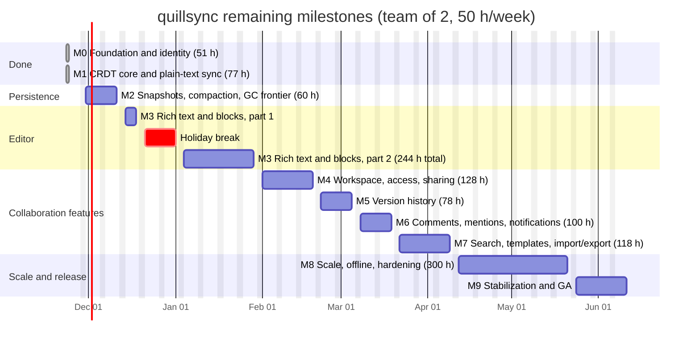

# Roadmap

This roadmap groups the 99 tickets in [backlog.md](backlog.md) into milestones M0 to M9. Ticket estimates and statuses come from the backlog, which takes precedence if anything here disagrees with it. Requirement IDs refer to [../product/requirements.md](../product/requirements.md).

## Planning assumptions

- **Team:** 2 engineers.
- **Capacity:** 25 focused engineering hours per engineer per week, so **50 h/week** for the team. The rest of the time goes to review, support and meetings. Backlog estimates already include tests and documentation.
- **Calendar:** remaining work starts Monday 2026-11-30. There is a two-week holiday break from 2026-12-21 to 2027-01-01.
- **Sequencing:** milestones run in order because of cross-milestone dependencies (for example, QS-070 needs QS-060, QS-102 needs QS-092, and QS-133 needs QS-050). Within a milestone both engineers work in parallel on independent tickets.
- **Remaining work:** 1028 h across 71 pending tickets, which is 20.6 team-weeks at full capacity. The schedule below uses 23 working weeks (including M9 stabilization), leaving about 13 % slack for estimate error.

## Milestone summary

| Milestone | Theme                                | Tickets |    Hours | Status     | Planned window                                  | Working weeks |
| --------- | ------------------------------------ | ------: | -------: | ---------- | ----------------------------------------------- | ------------: |
| M0        | Foundation and identity              |      13 |       51 | done       | complete                                        |           n/a |
| M1        | CRDT core and plain-text sync        |      15 |       77 | done       | complete                                        |           n/a |
| M2        | Persistence and compaction           |       5 |       60 | pending    | 2026-11-30 to 2026-12-11                        |             2 |
| M3        | Rich text and blocks                 |       8 |      244 | pending    | 2026-12-14 to 2027-01-29 (holiday break inside) |             5 |
| M4        | Workspace, access and sharing        |      12 |      128 | pending    | 2027-02-01 to 2027-02-19                        |             3 |
| M5        | Version history                      |       6 |       78 | pending    | 2027-02-22 to 2027-03-05                        |             2 |
| M6        | Comments, mentions and notifications |       8 |      100 | pending    | 2027-03-08 to 2027-03-19                        |             2 |
| M7        | Search, templates, import and export |      11 |      118 | pending    | 2027-03-22 to 2027-04-09                        |             3 |
| M8        | Scale, offline and hardening         |      21 |      300 | pending    | 2027-04-12 to 2027-05-21                        |             6 |
| M9        | Release stabilization                |       0 |        0 | pending    | 2027-05-24 to 2027-06-11                        |             3 |
| **Total** |                                      |  **99** | **1156** | 128 h done |                                                 |               |

M9 has no backlog tickets by design. It is a time-boxed stabilization window (see below). Defects found there become new tickets.

## Gantt

The bars for M0 and M1 show completion only. Their historical dates are not tracked in this document.

---

## M0: Foundation and identity (done, 51 h)

**Goal:** a runnable, tested skeleton with secure authentication and a consistent API contract.

**Tickets:** QS-001, QS-002, QS-003, QS-004, QS-005, QS-006, QS-007, QS-008, QS-009, QS-010, QS-011, QS-012, QS-013.

**Exit criteria (met):**

- `./run.sh` performs setup, migration, seeding and dev startup on a host with native PostgreSQL (FR-005).
- CI runs lint, format check, typecheck, tests and build on every push (NFR-025).
- Registration, login, logout and `me` work. CSRF, rate limiting and the RBAC matrix are enforced (FR-007 to FR-011, NFR-016 to NFR-018).
- Every designed but unbuilt endpoint returns 501 with its ticket ID (FR-006).

## M1: CRDT core and plain-text real-time sync (done, 77 h)

**Goal:** two or more people co-edit plain text with guaranteed convergence and durable storage.

**Tickets:** QS-020, QS-021, QS-022, QS-023, QS-024, QS-025, QS-026, QS-027, QS-030, QS-031, QS-032, QS-033, QS-034, QS-035, QS-036.

**Exit criteria (met):**

- The property tests show convergence and no interleaving for any delivery order (NFR-001 to NFR-003).
- Two real WebSocket clients converge. Ops persist and rooms rehydrate after a restart (FR-033 to FR-036, NFR-011).
- Presence carets, reconnect with resend, and viewer read-only enforcement work (FR-035, FR-037, FR-041).

## M2: Persistence and compaction (60 h)

**Goal:** storage and memory stay bounded, and rooms load quickly. This is the foundation for history and search.

**Tickets:** QS-060 (16), QS-061 (12), QS-062 (16), QS-063 (10), QS-064 (6).

**Exit criteria:**

- Snapshots are written on op count, on a timer and on room unload. Rehydration uses snapshot plus tail (FR-050). NFR-014 is measured on a seeded document with 100k ops.
- Op-log rows below the snapshot high-water mark are compacted, and text is identical before and after (FR-051).
- `document_replicas` tracks acknowledged vectors. Server GC removes stable, childless tombstones with no visible change (FR-052). Silent replicas are evicted and forced to resync (FR-053).
- The backup verification round trip reports zero mismatches on the seed database (FR-054).

## M3: Rich text and blocks (244 h)

**Goal:** a real document editor with formatting, blocks and per-user undo. This milestone starts the private beta.

**Tickets:** QS-040 (32), QS-041 (48), QS-042 (24), QS-044 (24), QS-046 (32), QS-047 (20), QS-050 (56), QS-051 (8).

**Exit criteria:**

- Marks and blocks converge under concurrent edits. The property tests are extended with mark and block operations and pass (FR-025, FR-026, FR-027; NFR-001 still holds).
- The contenteditable surface handles IME composition and selection mapping in Chromium, Firefox and WebKit (FR-042).
- Undo never removes another user's text (FR-029).
- Tables and local-disk images work (FR-031, FR-032).
- The plain-text editor is retired, and the seeded documents open in the rich editor.

## M4: Workspace, access and sharing (128 h)

**Goal:** teams onboard members, organize documents and control access.

**Tickets:** QS-014 (12), QS-015 (8), QS-016 (8), QS-017 (6), QS-018 (6), QS-056 (8), QS-090 (16), QS-091 (10), QS-092 (20), QS-093 (12), QS-094 (10), QS-140 (12).

**Exit criteria:**

- Invitation, password reset and signup activation messages appear in `outbox_messages`, and nothing is sent externally (FR-013, FR-014, FR-095, NFR-022).
- Folder tree, document lifecycle, per-document permissions with inheritance, and expiring share links work (FR-068 to FR-071).
- A permission downgrade affects open sockets within 5 s (FR-048, NFR-036).
- Every new endpoint that returned 501 now has passing integration tests, and `apps/api/test/pending.test.ts` is updated.

## M5: Version history (78 h)

**Goal:** writers save, compare and restore versions safely during live collaboration.

**Tickets:** QS-070 (12), QS-071 (8), QS-072 (20), QS-073 (16), QS-074 (16), QS-075 (6).

**Exit criteria:**

- Automatic checkpoints and named versions are listed (FR-055, FR-056).
- The diff is computed from item IDs (FR-057).
- Restore is applied as forward ops while another client types, and both clients converge with the concurrent keystrokes kept (FR-058).
- Compaction (FR-051) keeps the data needed by any retained version.

## M6: Comments, mentions and notifications (100 h)

**Goal:** a review workflow for commenters and viewers.

**Tickets:** QS-080 (20), QS-081 (12), QS-082 (16), QS-083 (16), QS-084 (10), QS-085 (8), QS-086 (6), QS-096 (12).

**Exit criteria:**

- Threads are anchored to CRDT ranges and survive deletes, GC and restore (FR-061, FR-062). GC never collects an anchored tombstone.
- Mentions notify only users who can read the document (FR-064). The notification center and digests to the outbox work (FR-065, FR-066).
- The activity feed respects permissions (FR-074).

## M7: Search, templates, import and export (118 h)

**Goal:** feature-complete for public beta.

**Tickets:** QS-095 (10), QS-100 (14), QS-101 (12), QS-102 (8), QS-103 (10), QS-104 (8), QS-110 (10), QS-111 (8), QS-112 (16), QS-113 (10), QS-114 (12).

**Exit criteria:**

- Search over the `tsvector` projection is permission-filtered and meets NFR-031 on the 10k-document benchmark database (FR-075 to FR-079).
- Markdown and HTML export and Markdown import pass the round-trip corpus (FR-080 to FR-082, NFR-032). HTML output passes the sanitizer tests.
- Export jobs and workspace archives are stored on local disk only (FR-083, FR-084).

## M8: Scale, offline and hardening (300 h)

**Goal:** production readiness. The system runs on multiple nodes, keeps offline edits durable, and is observable, accessible and secure.

**Tickets:** QS-019 (10), QS-043 (40), QS-045 (12), QS-052 (10), QS-053 (32), QS-054 (24), QS-055 (6), QS-057 (12), QS-120 (16), QS-121 (10), QS-122 (8), QS-130 (8), QS-131 (16), QS-132 (6), QS-133 (12), QS-134 (16), QS-135 (10), QS-136 (16), QS-137 (8), QS-138 (16), QS-139 (12).

**Exit criteria:**

- The load harness shows NFR-009 (p95 fan-out under 100 ms with 20 editors) and NFR-035 on the reference host. Failover meets NFR-033.
- The B-tree sequence passes the property tests and meets NFR-008. Memory meets NFR-012.
- Offline reload keeps edits, and the multi-browser E2E suite runs in CI (NFR-027, NFR-028).
- axe shows zero serious or critical violations (NFR-021). The CSP and dependency audit gate is active (NFR-020). TLS deployment scripts are verified (NFR-034).

## M9: Release stabilization (no backlog tickets)

**Goal:** general availability.

**Activities:** fix defects found in beta (each becomes a new ticket), verify every NFR target on the reference deployment and record the results, freeze documentation, and rehearse a release-candidate backup and restore.

**Exit criteria:**

- Every Must FR and Must NFR is `implemented` and verified.
- Success metrics SM-1 to SM-10 and SM-12 in [../product/PRD.md](../product/PRD.md#6-success-metrics) are met.
- There are no open defects of severity 1 or 2.
- `implementation-status.md` reads 100 % of the planned hours.

## Schedule risk

The longest chain is QS-040 → QS-041 → QS-050 (136 h, in M3) → QS-133 and QS-138 (M8). A slip in the editor surface (QS-050) pushes both M3 and the accessibility exit criterion of M8. See R-07 and R-08 in [risks.md](risks.md).
