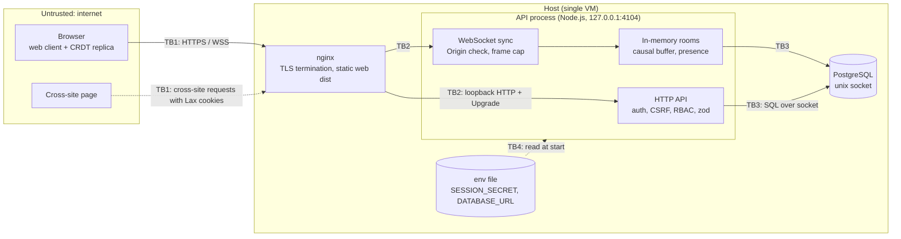

# Threat model

Scope: the quillsync modular monolith as it exists today (Fastify API with WebSocket sync, React web client, PostgreSQL) plus the planned surface in [../api/openapi.yaml](../api/openapi.yaml). Method: asset and actor inventory, trust boundaries, STRIDE per component, mitigations with status, OWASP ASVS 4.0 mapping, residual risks.

Every mitigation is marked **implemented** (merged, covered by a test named below) or **pending** (with the backlog ticket from [../planning/backlog.md](../planning/backlog.md)). Requirement IDs (FR/NFR) are in [../product/requirements.md](../product/requirements.md); architecture context is in [../architecture/overview.md](../architecture/overview.md) and [../design/system-design.md](../design/system-design.md).

## Assets

| ID  | Asset                     | Where it lives                                                         | Why it matters                                                                                                      |
| --- | ------------------------- | ---------------------------------------------------------------------- | ------------------------------------------------------------------------------------------------------------------- |
| A1  | Document content (op log) | `document_ops.payload` (binary codec), in-memory rooms, browser memory | The product's core data; confidentiality and integrity per organization. Tombstoned text is still present until GC. |
| A2  | Document metadata         | `documents`                                                            | Titles leak information on their own.                                                                               |
| A3  | Credentials               | `users.password_hash` (scrypt)                                         | Account takeover.                                                                                                   |
| A4  | Session tokens            | Browser cookie `qs_session`; `sessions.token_hash` (HMAC-SHA256)       | Bearer credential for HTTP and WebSocket.                                                                           |
| A5  | CSRF token                | `qs_csrf` cookie, `x-csrf-token` header                                | Guards state-changing requests.                                                                                     |
| A6  | Membership and roles      | `memberships`                                                          | Authorization decisions.                                                                                            |
| A7  | Audit trail               | `audit_log`                                                            | Accountability, incident investigation.                                                                             |
| A8  | Configuration secrets     | `.env` / `/etc/quillsync/api.env` (`SESSION_SECRET`, `DATABASE_URL`)   | Signing material and database access.                                                                               |
| A9  | Service availability      | API process, rooms, PostgreSQL                                         | Real-time editing is useless if the room is down or wedged.                                                         |
| A10 | Presence data             | In-memory rooms                                                        | Reveals who is reading which document and where.                                                                    |

## Actors

| Actor                                                      | Trust                                           | Capabilities                                                                                                           |
| ---------------------------------------------------------- | ----------------------------------------------- | ---------------------------------------------------------------------------------------------------------------------- |
| Anonymous internet user                                    | none                                            | Reach `/api/health`, `/api/ready`, register, login, password reset (pending).                                          |
| Authenticated member (viewer / commenter / editor / owner) | scoped to one organization and role             | HTTP API and WebSocket within their organization. Holds a valid client and can craft arbitrary frames.                 |
| Malicious member                                           | scoped, hostile                                 | Crafts op payloads, spoofs CRDT ids, floods rooms, probes other tenants' ids.                                          |
| Cross-site attacker                                        | none, but controls a web page the victim visits | Can make the victim's browser send requests with `SameSite=Lax` cookies (top-level navigations, WebSocket handshakes). |
| Network attacker                                           | on-path                                         | Sniffs or tampers with traffic not protected by TLS.                                                                   |
| Operator                                                   | full                                            | Shell on the host, database superuser, reads env file and logs.                                                        |
| Compromised dependency                                     | full process privileges                         | Supply-chain code inside the API or web bundle.                                                                        |

## Trust boundaries

- **TB1 internet → nginx**: everything from the browser is untrusted, including CRDT runs produced by "our" client.
- **TB2 nginx → API**: API binds to `127.0.0.1`; only nginx reaches it. nginx must forward `Origin` and upgrade headers unchanged.
- **TB3 API → PostgreSQL**: local unix socket; database role owns only the quillsync database.
- **TB4 configuration**: env file readable only by root and the service group.
- Tenant boundary (logical, inside TB2/TB3): every row carries `organization_id`; every query filters by the session's organization.

## STRIDE analysis

Legend: **I** = implemented, **P** = pending (ticket).

### HTTP API (Fastify, `apps/api/src/http`, `modules/auth`, `modules/documents`)

| STRIDE | Threat                                                    | Mitigation                                                                                                                                                                                                                                                                                                                                               | Status                                                |
| ------ | --------------------------------------------------------- | -------------------------------------------------------------------------------------------------------------------------------------------------------------------------------------------------------------------------------------------------------------------------------------------------------------------------------------------------------- | ----------------------------------------------------- |
| S      | Credential stuffing / brute force on login                | Per normalised IP fixed window (`LOGIN_IP_RATE_LIMIT_MAX`), distinct emails per IP (`LOGIN_EMAILS_PER_IP_MAX`), per-email progressive backoff (`LOGIN_EMAIL_FREE_ATTEMPTS`, 30 s doubling to 15 min); attempts reserved before any await; IPv6 collapsed to /64; bounded stores sweep then evict least-time-left (never refuse new keys); scrypt hashing | I (QS-010, `auth.test.ts`, `rate-limit.test.ts`)      |
| S      | User enumeration via register/login responses             | Login returns the same `401 UNAUTHENTICATED` for unknown email and wrong password; register conflict reveals email existence                                                                                                                                                                                                                             | I for login; register leak accepted (see residual R5) |
| S      | Password reset token guessing                             | 32-byte random single-use token, hashed at rest, short expiry, all sessions revoked on reset                                                                                                                                                                                                                                                             | P (QS-015)                                            |
| T      | Mass assignment / unexpected fields                       | zod schemas reject unknown properties; ids and `organization_id` never taken from the body                                                                                                                                                                                                                                                               | I (`documents.test.ts`)                               |
| R      | Member denies having created or changed something         | `audit_log` row per security-relevant action with actor, request id, metadata                                                                                                                                                                                                                                                                            | I (QS-012); query API P (QS-019)                      |
| I      | Stack traces or SQL errors in responses                   | Central error handler maps to the envelope; `INTERNAL` returns a generic message, details only in logs                                                                                                                                                                                                                                                   | I (QS-003)                                            |
| I      | Cross-tenant read via guessed UUID                        | Organization filter in every repository query; other tenants' ids return 404                                                                                                                                                                                                                                                                             | I (`documents.test.ts`)                               |
| D      | Large request bodies                                      | Fastify body limit; zod max lengths on strings                                                                                                                                                                                                                                                                                                           | I                                                     |
| D      | Expensive list queries                                    | `limit` max 100, keyset pagination                                                                                                                                                                                                                                                                                                                       | I for documents                                       |
| E      | Viewer/commenter performing editor actions                | RBAC matrix in `packages/shared/src/rbac/permissions.ts`, `auth-guard.ts` per route                                                                                                                                                                                                                                                                      | I (QS-011, `rbac.test.ts`, `documents.test.ts`)       |
| E      | Per-document restrictions narrower than organization role | Document permissions with folder inheritance                                                                                                                                                                                                                                                                                                             | P (QS-092)                                            |

### Sessions and CSRF (`modules/auth`, `http/csrf.ts`)

| STRIDE | Threat                                         | Mitigation                                                                                                               | Status                                       |
| ------ | ---------------------------------------------- | ------------------------------------------------------------------------------------------------------------------------ | -------------------------------------------- |
| S      | Session token theft via XSS                    | `qs_session` is `HttpOnly`; React escapes output; no HTML rendering of document text (plain textarea)                    | I; CSP P (QS-132)                            |
| S      | Session token theft from a database dump       | Only `hmac_sha256(SESSION_SECRET, token)` stored in `sessions.token_hash`                                                | I (QS-009)                                   |
| S      | Token sniffing on the network                  | `Secure` cookie in production; TLS at nginx; HSTS                                                                        | I (cookie flag); nginx TLS config P (QS-137) |
| S      | Session fixation                               | New random token on every login and registration; logout deletes the row                                                 | I (`auth.test.ts`)                           |
| T      | CSRF on state-changing endpoints               | `SameSite=Lax` plus double-submit `qs_csrf` cookie / `x-csrf-token` header on POST/PUT/PATCH/DELETE → `403 CSRF_INVALID` | I (QS-010, `auth.test.ts`)                   |
| E      | Stolen session usable for a long time          | `expires_at` = `SESSION_TTL_HOURS` (168); listing and revoking sessions, idle timeout                                    | I (absolute expiry); P (QS-016)              |
| E      | Revoked or downgraded user keeps a live socket | Re-authorize on role change and session revocation, close affected sockets                                               | P (QS-056)                                   |

### WebSocket sync (`modules/collab`: `sync.routes.ts`, `connection.ts`, `room.ts`)

| STRIDE | Threat                                                                                                                                                                          | Mitigation                                                                                                                                                                | Status                                                                                 |
| ------ | ------------------------------------------------------------------------------------------------------------------------------------------------------------------------------- | ------------------------------------------------------------------------------------------------------------------------------------------------------------------------- | -------------------------------------------------------------------------------------- |
| S      | **Cross-site WebSocket hijacking**: attacker page opens `wss://.../sync`; browser attaches the Lax session cookie to the handshake                                              | Upgrade refused with 403 unless `Origin` equals `APP_ORIGIN` exactly                                                                                                      | I (`collab-sync.test.ts` "bad origin rejected")                                        |
| S      | **CRDT id spoofing**: member sends runs with another replica's `client` id to overwrite or pre-empt that replica's seq space (later genuine ops would be dropped as duplicates) | Server checks that every run's `client` equals the connection's `hello` `clientId`; otherwise `error` FORBIDDEN and the batch is discarded                                | I (QS-030)                                                                             |
| T      | **Malicious op payloads**: origin/target referencing non-existent items, negative or zero seq, empty text, wrong `k`, Lamport regression                                        | zod schemas (`protocol/messages.ts`) with integer bounds; causal check requires `seq == vector[client]+1` and origin/target present before integration                    | I (`protocol.test.ts`, `integrate.test.ts`, `collab-sync.test.ts` "malformed message") |
| T      | Corrupted persisted payload or crafted binary                                                                                                                                   | Binary codec bounds-checks every varint, length and dictionary index; malformed input throws `CodecError`; fuzzed                                                         | I (QS-024, `codec.test.ts`)                                                            |
| T      | Viewer/commenter sending ops                                                                                                                                                    | Role resolved at upgrade; `ops` from read-only roles answered with `error` FORBIDDEN                                                                                      | I (`collab-sync.test.ts` "viewer rejected")                                            |
| R      | Who typed what                                                                                                                                                                  | `document_ops.author_user_id` per batch, tied to the authenticated user, not the client-chosen id                                                                         | I (QS-031)                                                                             |
| I      | Presence reveals readers to unauthorized users                                                                                                                                  | Presence only delivered inside a room the socket was authorized to join                                                                                                   | I                                                                                      |
| D      | **Oversized frames**                                                                                                                                                            | `WS_MAX_MESSAGE_BYTES` (262144) enforced by `ws`; socket closed with 1009                                                                                                 | I                                                                                      |
| D      | **Causal-buffer exhaustion**: member sends runs with deliberate seq gaps or dangling origins that never become ready, filling the pending buffer                                | Own-client constraint limits gaps to the sender's own seq space; frame cap bounds each batch; per-connection pending-buffer cap, eviction on disconnect and op rate limit | I (own-client check); P (QS-052 for caps/rate)                                         |
| D      | Op flood (many small frames)                                                                                                                                                    | Per-connection token bucket, backpressure on slow consumers                                                                                                               | P (QS-052)                                                                             |
| D      | Room memory growth: huge documents, tombstone accumulation                                                                                                                      | Room unloaded when idle; tombstone GC library ready; server GC frontier and snapshots                                                                                     | I (unload, GC library QS-025); P (QS-060, QS-062)                                      |
| D      | Presence storms with many editors                                                                                                                                               | Throttling and sampling                                                                                                                                                   | P (QS-057)                                                                             |
| E      | Join a room of another organization                                                                                                                                             | Upgrade route loads the document scoped to the session's organization; 404 otherwise                                                                                      | I (`collab-sync.test.ts`)                                                              |

### Tenant isolation (all modules)

| STRIDE | Threat                                          | Mitigation                                                                                                                       | Status                   |
| ------ | ----------------------------------------------- | -------------------------------------------------------------------------------------------------------------------------------- | ------------------------ |
| I      | Missing `organization_id` filter in a new query | Repositories take `organizationId` as a required argument; integration tests create two organizations and assert 404 across them | I for documents and sync |
| I      | Search leaking documents the user cannot read   | Permission-aware filtering in SQL, not post-filtering in JS                                                                      | P (QS-102)               |
| E      | Multi-organization membership confuses context  | Session bound to one `organization_id`; workspace switcher issues a new session                                                  | I (binding); P (QS-094)  |

### PostgreSQL

| STRIDE | Threat                          | Mitigation                                                                                             | Status                                                                                     |
| ------ | ------------------------------- | ------------------------------------------------------------------------------------------------------ | ------------------------------------------------------------------------------------------ |
| T      | SQL injection                   | All queries via `pg` parameter placeholders; no string concatenation of input                          | I                                                                                          |
| T      | Duplicate op batches on retry   | `UNIQUE(document_id, client_id, seq_start)` on `document_ops`; room only persists newly integrated ops | I (QS-031)                                                                                 |
| T      | Migration tampering or drift    | Forward-only runner with stored checksums; mismatch aborts startup                                     | I (QS-005, `migrate.test.ts`)                                                              |
| I      | Database exposed on the network | Local unix socket (`/tmp` in dev); `listen_addresses` limited in production; peer or scram auth        | I (dev); deployment guidance in [../operations/deployment.md](../operations/deployment.md) |
| I      | Backups readable by others      | `pg_dump` files mode 0600, stored off-host encrypted                                                   | P (QS-064 verification tooling)                                                            |
| D      | Connection exhaustion           | `DB_POOL_MAX` (10) per process                                                                         | I                                                                                          |

### Web client and supply chain

| STRIDE | Threat                                                      | Mitigation                                                    | Status                   |
| ------ | ----------------------------------------------------------- | ------------------------------------------------------------- | ------------------------ |
| T      | Script injection via document text, titles or display names | React text rendering only; remote carets render names as text | I                        |
| T      | Injection once rich text and HTML export land               | Sanitized HTML export; CSP                                    | P (QS-111, QS-132)       |
| T      | Compromised npm dependency                                  | Lockfile, `npm ci`; dependency audit gate in CI               | I (lockfile); P (QS-132) |
| I      | Offline data on shared machines                             | IndexedDB cleared on logout                                   | P (QS-120)               |

## Mitigation summary

| Mitigation                                                               | Status      | Ticket         |
| ------------------------------------------------------------------------ | ----------- | -------------- |
| scrypt password hashing                                                  | implemented | QS-008         |
| Hashed session tokens, HttpOnly/SameSite=Lax/Secure cookie, absolute TTL | implemented | QS-009         |
| Double-submit CSRF, login rate limit                                     | implemented | QS-010         |
| RBAC matrix and route guards                                             | implemented | QS-011         |
| Audit log writes                                                         | implemented | QS-012         |
| WebSocket Origin check, frame size cap, zod frame validation             | implemented | QS-030         |
| Run client id must equal hello clientId                                  | implemented | QS-030         |
| Causal readiness check, idempotent delivery                              | implemented | QS-022         |
| Codec bounds checks + fuzzing                                            | implemented | QS-024         |
| Unique op batches, forward-only checksummed migrations                   | implemented | QS-031, QS-005 |
| Password reset with hashed single-use tokens                             | pending     | QS-015         |
| Session list/revoke, idle timeout                                        | pending     | QS-016         |
| Audit query API                                                          | pending     | QS-019         |
| Op rate limiting, backpressure, pending-buffer cap                       | pending     | QS-052         |
| Re-authorization on live sockets                                         | pending     | QS-056         |
| Presence throttling                                                      | pending     | QS-057         |
| Snapshots and server GC frontier (bounded memory)                        | pending     | QS-060, QS-062 |
| Backup/restore verification                                              | pending     | QS-064         |
| Per-document permissions                                                 | pending     | QS-092         |
| Permission-aware search                                                  | pending     | QS-102         |
| Sanitized HTML export                                                    | pending     | QS-111         |
| CSP, security headers, dependency audit gate                             | pending     | QS-132         |
| nginx/systemd hardening and TLS                                          | pending     | QS-137         |

## OWASP ASVS 4.0 mapping

Target level: ASVS Level 2 for implemented features.

| Chapter                       | Requirement focus                                                                                        | quillsync control                                                                                                        | Status                                                |
| ----------------------------- | -------------------------------------------------------------------------------------------------------- | ------------------------------------------------------------------------------------------------------------------------ | ----------------------------------------------------- |
| V2 Authentication             | 2.1 password length ≥ 10, no composition rules; 2.4 adaptive hashing; 2.2 anti-automation                | Register enforces minimum length; scrypt with per-user salt; login limiter per IP + email                                | implemented (QS-008, QS-010)                          |
| V2 Authentication             | 2.5 credential recovery                                                                                  | Outbox-delivered reset token, single use, sessions revoked                                                               | pending (QS-015)                                      |
| V3 Session management         | 3.2 token entropy ≥ 64 bits; 3.4 cookie attributes                                                       | 256-bit random token, stored hashed; `HttpOnly`, `SameSite=Lax`, `Secure` in production, `Path=/`                        | implemented (QS-009)                                  |
| V3 Session management         | 3.3 logout and timeout; 3.7 re-authentication                                                            | Logout deletes row; absolute expiry 168 h; idle timeout, session list/revoke                                             | implemented (logout, absolute); pending (QS-016)      |
| V4 Access control             | 4.1 server-side enforcement, deny by default; 4.2 IDOR                                                   | RBAC guard on every route and on WebSocket upgrade; organization filter on every query, 404 for foreign ids              | implemented (QS-011, QS-030, QS-033)                  |
| V4 Access control             | 4.2.2 CSRF                                                                                               | Double-submit token + SameSite=Lax; Origin check on WebSocket                                                            | implemented (QS-010, QS-030)                          |
| V4 Access control             | 4.1.3 least privilege per object                                                                         | Per-document permissions, live-socket revocation                                                                         | pending (QS-092, QS-056)                              |
| V5 Validation                 | 5.1 input validation; 5.3 output encoding; 5.3.4 parameterized queries                                   | zod on HTTP and WS; codec bounds checks; React escaping; `pg` placeholders                                               | implemented                                           |
| V5 Validation                 | 5.2 sanitization of rich content                                                                         | HTML export sanitizer                                                                                                    | pending (QS-111)                                      |
| V7 Error handling and logging | 7.1 no secrets in logs; 7.2 security events logged; 7.4 generic errors                                   | pino JSON with request ids; no request bodies or cookie values in log lines; audit_log; envelope with generic `INTERNAL` | implemented (QS-002, QS-003, QS-012)                  |
| V8 Data protection            | 8.1 server-side data protection; 8.2 client-side; 8.3 sensitive data                                     | Session tokens and reset tokens hashed; no document content in logs; offline cache wiping on logout                      | implemented (hashing); pending (QS-120)               |
| V9 Communications             | 9.1 TLS for all client connections; 9.2 server communications                                            | nginx TLS 1.2+/1.3 with HSTS, WSS only in production; API and PostgreSQL on loopback/socket                              | pending (QS-137); loopback binding implemented        |
| V13 API and web service       | 13.1 generic API security; 13.2 RESTful (content type, CSRF); 13.5 WebSocket (Origin, auth on handshake) | Strict `application/json`, envelope, 501 for pending routes, WebSocket session + Origin check, frame cap                 | implemented (QS-003, QS-013, QS-030)                  |
| V14 Configuration             | 14.1 build and deploy; 14.2 dependencies; 14.4 HTTP security headers; 14.3 unintended disclosure         | zod-validated config fails fast; `SESSION_SECRET` ≥ 32 chars; env file 0640; CSP and headers, audit gate                 | implemented (config QS-002); pending (QS-132, QS-137) |

## Authentication abuse controls (implemented)

| Control                             | Design                                                                                                                                                                                                                                                                                                                                                           | Verified by                                               |
| ----------------------------------- | ---------------------------------------------------------------------------------------------------------------------------------------------------------------------------------------------------------------------------------------------------------------------------------------------------------------------------------------------------------------- | --------------------------------------------------------- |
| Client IP derivation                | `TRUST_PROXY` is `false` (default), a hop count, or a list of proxy IPs/CIDRs; `true` is rejected and production refuses to start when it is unset, so `X-Forwarded-For` is never trusted by accident.                                                                                                                                                           | `config.test.ts`                                          |
| IP normalisation                    | IPv4-mapped IPv6 becomes IPv4; other IPv6 addresses collapse to their /64 so rotating addresses inside one allocation share a bucket.                                                                                                                                                                                                                            | `rate-limit.test.ts`, `auth.test.ts`                      |
| Password spraying                   | Fixed window per normalised IP (`LOGIN_IP_RATE_LIMIT_MAX`, 30 per 15 min) plus a cap on distinct emails per IP (`LOGIN_EMAILS_PER_IP_MAX`, 20 per 15 min).                                                                                                                                                                                                       | `auth.test.ts`                                            |
| Distributed guessing on one account | Per-email progressive backoff: `LOGIN_EMAIL_FREE_ATTEMPTS` (5) free attempts, then 30 s doubling to 15 min; forgotten after 24 h; reset on success.                                                                                                                                                                                                              | `auth.test.ts`, `rate-limit.test.ts`                      |
| Parallel-request races              | Every limiter reserves the attempt synchronously before the first `await` (scrypt verification), so parallel bad logins cannot all pass the check.                                                                                                                                                                                                               | `auth.test.ts` (8 parallel bad logins → 3 × 401, 5 × 429) |
| Limiter memory exhaustion           | Stores are bounded (50k keys). When full, expired entries are swept with a resumable cursor covering the whole map; if it is still full of active entries the one with the least time left is evicted and a warning is logged. New keys are never refused because the store is full, so an attacker cannot lock everyone out by filling it.                      | `rate-limit.test.ts`                                      |
| Account enumeration                 | Registration answers the same 202 body for new and existing emails, hashes the password on both paths and never sets cookies; login uses one generic message and verifies against a dummy hash for unknown emails. Registration is rate limited per IP (`REGISTER_IP_RATE_LIMIT_MAX`, 5 per hour). Verified signup through the local outbox is planned (QS-140). | `auth.test.ts`                                            |
| Multi-instance                      | All counters live in process memory. Before running more than one API instance they must move to PostgreSQL (shared counters with `UPDATE ... RETURNING`), tracked with QS-053.                                                                                                                                                                                  | design note                                               |

## Residual risks

| ID  | Risk                                                                                                                                               | Why accepted now                                                                                            | Planned reduction                                                                |
| --- | -------------------------------------------------------------------------------------------------------------------------------------------------- | ----------------------------------------------------------------------------------------------------------- | -------------------------------------------------------------------------------- |
| R1  | A hostile editor can flood a room with valid ops (and fill the pending buffer within its own seq space) until the process is under memory pressure | Frame cap bounds a single message; members are authenticated and audited                                    | QS-052, QS-131 load tests                                                        |
| R2  | Role changes do not affect sockets already open                                                                                                    | No role-change API exists yet (QS-017 pending), so roles cannot change at runtime today                     | QS-056                                                                           |
| R3  | Deleted text remains in `document_ops` and in tombstones indefinitely                                                                              | Required for convergence until GC frontier and compaction exist                                             | QS-061, QS-062, QS-135                                                           |
| R4  | Login and registration throttle counters are per process and in memory; they must move to PostgreSQL before running more than one API instance     | Single-node deployment                                                                                      | Move to PostgreSQL with QS-053 multi-node work                                   |
| R5  | Registration activates accounts without email verification (responses no longer reveal existing emails)                                            | Identical 202 response for new and existing emails, IP rate limit; verified signup via local outbox planned | QS-140                                                                           |
| R6  | No CSP or security headers beyond cookie flags                                                                                                     | Plain-text editor without HTML rendering limits XSS surface                                                 | QS-132                                                                           |
| R7  | Single API process is a single point of failure for live editing                                                                                   | Rooms are in-memory per process                                                                             | QS-053, QS-054                                                                   |
| R8  | Operator has full access to all organizations' content                                                                                             | Self-hosted single-tenant-operator model                                                                    | Out of scope; documented in [../operations/runbook.md](../operations/runbook.md) |
