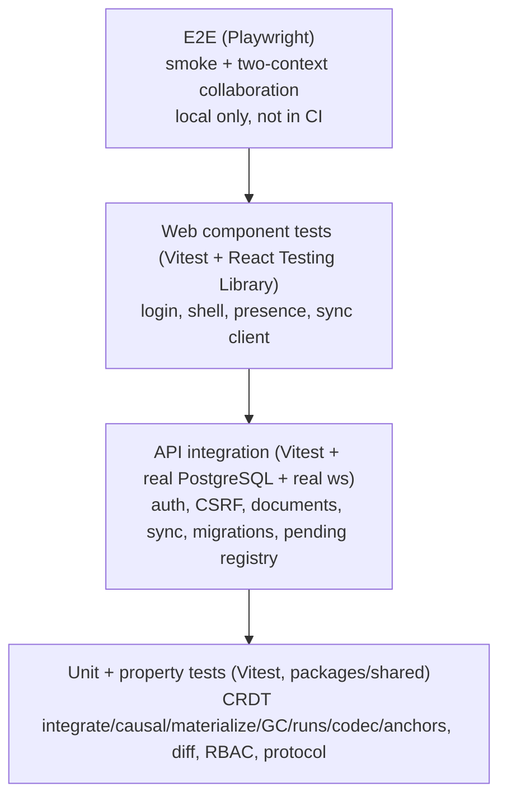

# Test strategy

How quillsync is tested, where each kind of test lives, what the coverage gates are and how to run everything locally and in CI. Requirement IDs referenced by tests are traced in [../product/requirements-traceability.md](../product/requirements-traceability.md); ticket status comes from [../planning/backlog.md](../planning/backlog.md).

## Principles

1. **The CRDT is proven by properties, not examples.** Convergence, idempotence and order-insensitivity are asserted over thousands of seeded random histories; example tests document specific interleavings.
2. **Integration tests use the real database and real sockets.** API tests run against PostgreSQL (`TEST_DATABASE_URL`) and open real `ws` connections to a listening Fastify instance. No database mocks.
3. **Pure code stays pure.** `packages/shared` has no I/O, so its tests are fast and deterministic.
4. **Pending features have contract tests, not feature tests.** Every pending route is asserted to return `501 NOT_IMPLEMENTED` with its ticket; when a ticket starts, that assertion is replaced by real tests written first.
5. **Every bug fix starts with a failing test** at the lowest layer that reproduces it.

## Pyramid

| Layer                                    | Runner                               |      Approx. share | Speed           | In CI                      |
| ---------------------------------------- | ------------------------------------ | -----------------: | --------------- | -------------------------- |
| Unit + property (`packages/shared/test`) | Vitest                               | ~60% of test cases | seconds         | yes                        |
| API integration (`apps/api/test`)        | Vitest, PostgreSQL, `ws`             |               ~25% | tens of seconds | yes                        |
| Web component (`apps/web/test`)          | Vitest, jsdom, React Testing Library |               ~12% | seconds         | yes                        |
| E2E (`e2e/`)                             | Playwright                           |                ~3% | minutes         | no (local and pre-release) |

## What is tested where

### `packages/shared` — unit and property tests

| File                                     | Covers                                                                                                                                                                                                                                                                                                                                                                                                                                                                                                                                                                                                                            |
| ---------------------------------------- | --------------------------------------------------------------------------------------------------------------------------------------------------------------------------------------------------------------------------------------------------------------------------------------------------------------------------------------------------------------------------------------------------------------------------------------------------------------------------------------------------------------------------------------------------------------------------------------------------------------------------------- |
| `test/crdt/integrate.test.ts`            | RGA scan integration and causal delivery (readiness rule `seq == vector[client]+1` plus origin/target present, pending buffer, duplicates dropped, invalid stamps rejected): insert after origin, skip items with greater `(lamport, client)`, tombstoning, concurrent inserts at the same origin, runs typed at the same position never interleave.                                                                                                                                                                                                                                                                              |
| `test/crdt/ids.test.ts`                  | Stamp ordering, vector merge/min/dominance, own-property reads (`constructor` is not a client), client-id pattern.                                                                                                                                                                                                                                                                                                                                                                                                                                                                                                                |
| `test/crdt/convergence.property.test.ts` | Seeded property harness (QS-027). For each seed: 2–5 replicas perform random concurrent inserts and deletes at random positions; ops are delivered to every replica in an independently shuffled order, with random duplication and delayed delivery. Asserts (a) all replicas materialize identical text and identical state vectors, (b) scan integration equals timestamp-tree materialization, (c) re-delivering every op again changes nothing, (d) encoding to runs and back is lossless. Seeds are fixed lists in the file and each test case is named after its seed, so a failure is reproducible with `-t "seed <n>:"`. |
| `test/crdt/materialize.test.ts`          | Timestamp tree (children sorted descending by `(lamport, client)`, pre-order DFS) matches scan order; batch merge path used when k > 32.                                                                                                                                                                                                                                                                                                                                                                                                                                                                                          |
| `test/crdt/gc.test.ts`                   | Stable vector = pointwise min; only causally stable, childless tombstones are collected; positions of visible text unchanged; ops arriving after GC still integrate identically.                                                                                                                                                                                                                                                                                                                                                                                                                                                  |
| `test/crdt/runs.test.ts`                 | Run-length compression: consecutive inserts collapse only when seq, Lamport and origin chain are consecutive; delete target ranges merge; expand(compress(x)) = x.                                                                                                                                                                                                                                                                                                                                                                                                                                                                |
| `test/crdt/codec.test.ts`                | Binary codec round trip (LEB128 varints, client dictionary, UTF-8 incl. astral code points); fuzz: random byte strings, truncations and bit flips of valid payloads must either decode to a valid structure or throw `CodecError` — never hang, never throw anything else, never allocate beyond input-derived bounds.                                                                                                                                                                                                                                                                                                            |
| `test/crdt/anchors.test.ts`              | Anchors resolve after concurrent inserts before/after them and after the anchor character is tombstoned.                                                                                                                                                                                                                                                                                                                                                                                                                                                                                                                          |
| `test/text/diff.test.ts`                 | Common prefix/suffix diff yields at most one delete and one insert; surrogate pairs are not split.                                                                                                                                                                                                                                                                                                                                                                                                                                                                                                                                |
| `test/rbac.test.ts`                      | Full role × permission matrix.                                                                                                                                                                                                                                                                                                                                                                                                                                                                                                                                                                                                    |
| `test/protocol.test.ts`                  | zod schemas for every client/server frame: valid frames pass, wrong `type`, negative seq, missing fields and extra fields fail.                                                                                                                                                                                                                                                                                                                                                                                                                                                                                                   |

### `apps/api` — integration tests

Each test file builds its own Fastify app against the shared `quillsync_test` database (reset and migrated once by `test/global-setup.ts`, which refuses any database whose name does not end in `_test`); suites truncate tables between tests and run sequentially. `collab-sync.test.ts` listens on an ephemeral port for real `ws` clients; the others use `app.inject`.

| File                       | Covers                                                                                                                                                                                                                                                                                                                                                                                                 |
| -------------------------- | ------------------------------------------------------------------------------------------------------------------------------------------------------------------------------------------------------------------------------------------------------------------------------------------------------------------------------------------------------------------------------------------------------ |
| `test/config.test.ts`      | Env parsing defaults, `SESSION_SECRET` length and placeholder checks, `TRUST_PROXY` parsing (false, hop count, CIDR list, `true` rejected) and required in production.                                                                                                                                                                                                                                 |
| `test/migrate.test.ts`     | Migrations apply in order on an empty database, are idempotent, and a modified applied file fails with a checksum error.                                                                                                                                                                                                                                                                               |
| `test/health.test.ts`      | `/api/health` 200; `/api/ready` 200 with database, 503 when the pool cannot connect.                                                                                                                                                                                                                                                                                                                   |
| `test/auth.test.ts`        | Register answers an identical 202 for new and duplicate emails (no session, duplicate audited); validation; login/logout/me; forged and expired sessions 401; cookie attributes; CSRF missing/wrong → 403 `CSRF_INVALID`; per-email progressive lockout across many IPs; per-IP spraying and distinct-email caps; IPv6 /64 grouping; 8 parallel bad logins → 3 × 401 + 5 × 429; registration IP limit. |
| `test/rate-limit.test.ts`  | Fixed-window, distinct-key and progressive-backoff limiters with a fake clock; bounded stores sweep expired entries then evict the active entry with the least time left (never refuse new keys); IPv4-mapped and IPv6 /64 normalisation.                                                                                                                                                              |
| `test/seed.test.ts`        | Demo seed is idempotent and its two-replica history converges to the expected text.                                                                                                                                                                                                                                                                                                                    |
| `test/documents.test.ts`   | List/create/get; viewer cannot create; detail returns text, vector, opCount; cross-organization id → 404.                                                                                                                                                                                                                                                                                              |
| `test/room.test.ts`        | Room with an in-memory op-log store: rehydration and welcome deltas, persist-then-ack-then-fan-out exactly once (duplicate batches only re-acked), CLIENT_MISMATCH / CAUSALITY_VIOLATION / INVALID_OP / FORBIDDEN rejections leave state unchanged, persistence failure keeps state unchanged, presence and departures.                                                                                |
| `test/collab-sync.test.ts` | Two real `ws` clients edit concurrently and converge; reconnect with stale vector receives the delta; persistence + rehydration after room unload gives identical text; viewer `ops` rejected with FORBIDDEN; bad `Origin` → upgrade 403; malformed frame → `error` VALIDATION_ERROR; runs with a foreign client id rejected.                                                                          |
| `test/pending.test.ts`     | Table-driven over the pending route registry: each method + path returns 501 with the expected `details.ticket`. Keeps [../api/openapi.yaml](../api/openapi.yaml) and the code in sync.                                                                                                                                                                                                                |

### `apps/web` — component tests

| File                       | Covers                                                                                                                                                                                            |
| -------------------------- | ------------------------------------------------------------------------------------------------------------------------------------------------------------------------------------------------- |
| `test/login.test.tsx`      | Login form: server error message, navigation after sign-in, network failure message.                                                                                                              |
| `test/pages.test.tsx`      | Routing guard, planned pages, documents list/create, register then sign-in, editor page over a fake WebSocket (welcome, local ops, presence, caret restored after remote insert, offline status). |
| `test/app-shell.test.tsx`  | Layout, document list, "planned" badges on navigation for pending features.                                                                                                                       |
| `test/presence.test.tsx`   | Remote carets: deterministic colour per client id, name label, anchor → offset mapping.                                                                                                           |
| `test/sync-client.test.ts` | Sync engine against a fake socket: outbound queue, resend of unacked ops after reconnect, remote ops applied to the editor model, backoff schedule.                                               |

### `e2e/` — Playwright

| File                    | Covers                                                                                                         |
| ----------------------- | -------------------------------------------------------------------------------------------------------------- |
| `smoke.spec.ts`         | Log in as `ada@northwind.test`, open "Q3 launch plan", type, reload, text persisted.                           |
| `collaboration.spec.ts` | Two browser contexts (Ada and Grace) type concurrently into one document; both converge; remote caret visible. |

Expanded multi-browser suite is pending (QS-134).

## Coverage thresholds

- Enforced by Vitest's `coverage.thresholds` (v8 provider) per workspace on implemented code paths; CI runs `npm run test:coverage` and fails below the threshold: `packages/shared` 90% lines/functions/statements and 85% branches; `apps/api` and `apps/web` 80% lines/functions/statements and 75% branches. Current statement coverage: shared ~99%, API ~97%, web ~98%. Test counts: shared 251, API 86, web 24 (361 total).
- `packages/shared/src/crdt` is held to a higher informal bar (aim ≥ 95% branches) because convergence bugs are silent.
- Excluded from coverage: `apps/api/src/db/cli.ts` and `seed.ts` (exercised by `run.sh`), type-only files, `main`/bootstrap entry points. The pending-route registry is _included_ and covered by `pending.test.ts`.
- When a pending ticket lands, its code counts toward the threshold immediately; no grace period.

## Acceptance test matrix

| Feature                                               | Ticket     | Test file(s)                                              | Status                  |
| ----------------------------------------------------- | ---------- | --------------------------------------------------------- | ----------------------- |
| Config validation, logging                            | QS-002     | `apps/api/test/config.test.ts`                            | implemented             |
| Envelope, error handler                               | QS-003     | `health.test.ts`, `documents.test.ts`                     | implemented             |
| Health/readiness                                      | QS-004     | `health.test.ts`                                          | implemented             |
| Migration runner + checksums                          | QS-005     | `migrate.test.ts`                                         | implemented             |
| Registration                                          | QS-008     | `auth.test.ts`                                            | implemented             |
| Sessions, login/logout/me                             | QS-009     | `auth.test.ts`                                            | implemented             |
| CSRF + login rate limit                               | QS-010     | `auth.test.ts`, `rate-limit.test.ts`                      | implemented             |
| RBAC                                                  | QS-011     | `packages/shared/test/rbac.test.ts`, `documents.test.ts`  | implemented             |
| Pending registry 501                                  | QS-013     | `pending.test.ts`                                         | implemented             |
| CRDT ids, Lamport, vectors                            | QS-020     | `integrate.test.ts`, `ids.test.ts`                        | implemented             |
| RGA integration                                       | QS-021     | `integrate.test.ts`, `convergence.property.test.ts`       | implemented             |
| Causal buffer, idempotence                            | QS-022     | `integrate.test.ts`, `convergence.property.test.ts`       | implemented             |
| Tree materialization                                  | QS-023     | `materialize.test.ts`, `convergence.property.test.ts`     | implemented             |
| Runs + binary codec                                   | QS-024     | `runs.test.ts`, `codec.test.ts`                           | implemented             |
| Tombstone GC (library)                                | QS-025     | `gc.test.ts`                                              | implemented             |
| Anchors + diff                                        | QS-026     | `anchors.test.ts`, `diff.test.ts`                         | implemented             |
| Convergence harness                                   | QS-027     | `convergence.property.test.ts`                            | implemented             |
| WebSocket protocol + rooms                            | QS-030     | `protocol.test.ts`, `room.test.ts`, `collab-sync.test.ts` | implemented             |
| Op log persistence + rehydration                      | QS-031     | `collab-sync.test.ts`, `room.test.ts`                     | implemented             |
| Presence                                              | QS-032     | `collab-sync.test.ts`, `presence.test.tsx`                | implemented             |
| Document endpoints                                    | QS-033     | `documents.test.ts`                                       | implemented             |
| Web shell                                             | QS-034     | `login.test.tsx`, `app-shell.test.tsx`                    | implemented             |
| Collaborative editor                                  | QS-035     | `sync-client.test.ts`, `e2e/collaboration.spec.ts`        | implemented (e2e local) |
| Reconnect + resend                                    | QS-036     | `sync-client.test.ts`, `collab-sync.test.ts`              | implemented             |
| Snapshots / compaction / GC frontier                  | QS-060–063 | `apps/api/test/snapshots.test.ts` (planned)               | pending                 |
| Version history                                       | QS-070–075 | `versions.test.ts` (planned)                              | pending                 |
| Comments + anchors under GC                           | QS-080–082 | `comments.test.ts`, extended `anchors.test.ts` (planned)  | pending                 |
| Folders, document lifecycle, permissions, share links | QS-090–093 | `folders.test.ts`, `permissions.test.ts` (planned)        | pending                 |
| Search                                                | QS-100–104 | `search.test.ts` (planned)                                | pending                 |
| Import/export                                         | QS-110–114 | `export.test.ts`, `import.property.test.ts` (planned)     | pending                 |
| Offline persistence                                   | QS-120–122 | `apps/web/test/offline.test.ts` (planned)                 | pending                 |
| Rate limiting on sockets                              | QS-052     | `collab-sync.test.ts` additions (planned)                 | pending                 |
| Multi-node fan-out                                    | QS-053–054 | `multinode.test.ts` with two API processes (planned)      | pending                 |
| Load testing                                          | QS-131     | `load/` harness (planned)                                 | pending                 |
| Multi-browser e2e                                     | QS-134     | `e2e/` (planned)                                          | pending                 |

Until a pending row lands, its only coverage is the 501 assertion in `pending.test.ts`.

## How to run

Prerequisites: Node.js ≥ 22, PostgreSQL ≥ 15 running locally with a socket in `/tmp`. `./run.sh setup` creates `quillsync_dev` and `quillsync_test` and writes `.env`.

| What                                                    | Command                                                                                                                                                                                        |
| ------------------------------------------------------- | ---------------------------------------------------------------------------------------------------------------------------------------------------------------------------------------------- |
| Everything CI runs (lint, typecheck, all Vitest suites) | `./run.sh test`                                                                                                                                                                                |
| All Vitest suites                                       | `npm test`                                                                                                                                                                                     |
| One workspace                                           | `npm test -w packages/shared` · `npm test -w apps/api` · `npm test -w apps/web`                                                                                                                |
| One file                                                | `npx vitest run packages/shared/test/crdt/convergence.property.test.ts`                                                                                                                        |
| Investigate a failing property seed                     | Seeds are fixed lists inside each property test file (for example 120 seeds in `convergence.property.test.ts`); the failing test name contains the seed, so run that file with `-t "seed 42:"` |
| Coverage                                                | `npm test -- --coverage` (reports in `coverage/` per workspace)                                                                                                                                |
| API tests against a specific database                   | `TEST_DATABASE_URL=postgres:///quillsync_test?host=/tmp npm test -w apps/api`                                                                                                                  |
| E2E (starts API + web via Playwright `webServer`)       | `npx playwright install chromium` once, then `npx playwright test -c e2e/playwright.config.ts`                                                                                                 |

## CI behaviour

`.github/workflows/ci.yml` on `ubuntu-latest`:

1. `actions/setup-node` with Node 22 and npm cache.
2. `sudo systemctl start postgresql.service` (the runner's native PostgreSQL), then create the role and `quillsync_test` via `sudo -u postgres psql`. No service containers.
3. `npm ci`
4. `npm run lint`, `npm run format:check`, `npm run typecheck`
5. `npm test` with coverage thresholds enforced and `TEST_DATABASE_URL` pointing at the runner database.
6. `npm run build`

Any failing step fails the workflow. Playwright is not run in CI: it needs browsers and two dev servers and is run locally before each release (see [../operations/deployment.md](../operations/deployment.md)). Bringing collaboration e2e into CI is part of QS-134.

## Test data management

- **Databases**: `quillsync_dev` holds seed data for manual work; `quillsync_test` is used only by tests and may be wiped at any time. Tests refuse to run if `TEST_DATABASE_URL` points at a database whose name does not end in `_test`.
- **Schema**: the API test setup runs the real migration runner against `quillsync_test` once per run, so migrations are tested on every CI build.
- **Isolation**: each test file truncates the application tables (`TRUNCATE ... RESTART IDENTITY CASCADE`) in `beforeEach`, and builds its own fixtures through the public API (register → login → create document) or small factory helpers. No test depends on seed data or on another file's state. API test files run sequentially (single worker) because they share one database.
- **Seed data** (`./run.sh seed`): organization "Northwind Editorial", users `ada@`, `grace@`, `linus@northwind.test` with password `quillsync-demo-1`, and three documents with op-log history from two simulated replicas. Seed data is for development and e2e only, and is never loaded in production.
- **Randomness**: property and fuzz tests use a seeded PRNG; the seed is logged on failure. Client ids in tests are fixed strings so snapshots of runs are stable.

## Flake policy

- A test that fails intermittently is a bug. It is fixed or quarantined within one working day.
- Quarantine = `it.skip` with a comment `// FLAKY: <issue link>`; quarantined tests are reviewed weekly and may not stay skipped for more than two weeks.
- No automatic retries in Vitest config. Retries hide ordering bugs, which are exactly what a CRDT sync stack must not have.
- Timing: socket tests wait on protocol events (`ack`, `welcome`, `ops`) via promise helpers with a bounded timeout, never on fixed sleeps.
- A property-test failure is never treated as a flake: the printed seed is added as a permanent regression case.
